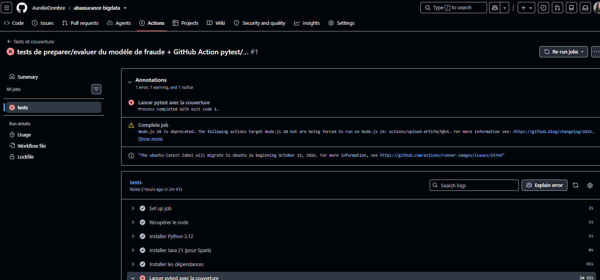
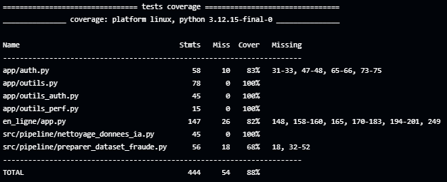
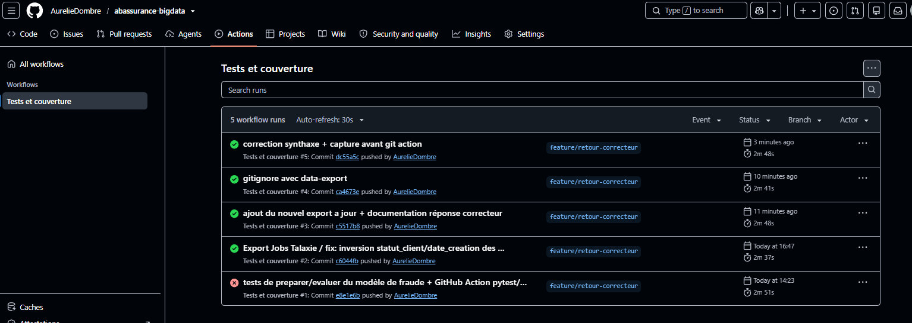
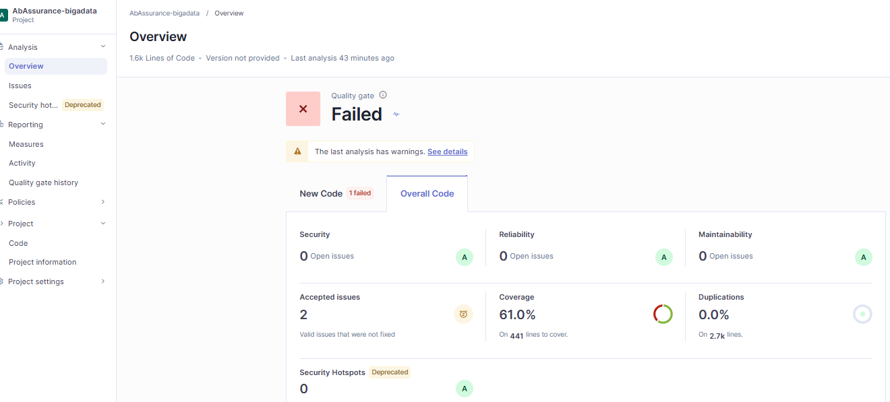
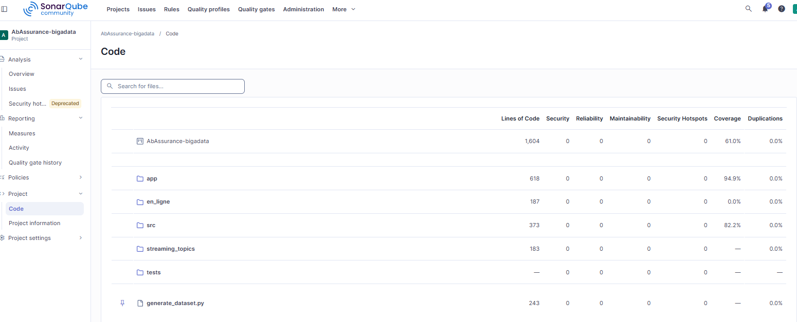

# Corrections suite au retour du correcteur

Branche de travail : `feature/retour-correcteur` (fusionnée ensuite dans `develop` puis `main`).

| # | Demande du correcteur | Statut | Où le vérifier |
| --- | --- | --- | --- |
| 1 | CI : GitHub Action qui lance pytest + couverture à chaque push | ✅ Fait | `.github/workflows/tests.yml`, onglet *Actions* du dépôt |
| 2 | Quality Gate : verdict + capture SonarQube à jour, cohérente avec 61 % | ✅ Fait | `Documentations/rapport_qualite.md` |
| 3 | Clients AssurePlus : corriger l'inversion `statut_client` / `date_creation` dans le job Talaxie de fusion, republier | ✅ Fait | `Export Jobs Talaxie/`, `tests/test_donnees_fusion.py` |
| 4 | Au moins deux tests sur `preparer` et `evaluer` de `entrainer_modele_fraude.py` | ✅ Fait (5 tests) | `tests/test_entrainer_modele_fraude.py` |
| 5 | Retirer `.idea/` et `.scannerwork/` du suivi Git | ✅ Fait | `.gitignore`, `git ls-files .idea .scannerwork` (vide) |

---

## 1. Intégration continue (GitHub Actions)

**Fichier :** `.github/workflows/tests.yml`

**Déclenchement :** à chaque `push` (toutes branches), à chaque pull request, et à la main (bouton *Run workflow*).

**Étapes :**

1. récupération du code sur une machine Linux neuve fournie par GitHub ;
2. installation de **Python 3.12** et **Java 21**, les mêmes versions que le conteneur Docker (Spark a besoin de Java) ;
3. installation des dépendances de `Docker/requirements.txt` ;
4. lancement de **tous les tests** avec `pytest` et mesure de la couverture (`pytest-cov`) ;
5. résumé de la couverture affiché dans l'onglet *Actions* ; rapports `coverage.xml` et `rapport_tests.xml` téléchargeables.

**Adaptation des tests Spark.** Ils n'étaient lancés que dans le conteneur Docker (présence du fichier `/.dockerenv`). Sur GitHub, ils auraient été sautés et la CI aurait affiché un faux succès. Ils tournent maintenant aussi lorsque la variable `CI=true` est définie, ce que GitHub fait automatiquement :

```python
pytestmark = pytest.mark.skipif(
    not (os.path.exists("/.dockerenv") or os.environ.get("CI") == "true"),
    reason="Tests Spark : à lancer dans le conteneur pyspark-app ou en CI",
)
```

**Autres fichiers modifiés :** `pytest.ini` (ajout de `src/prediction` au chemin), `.coveragerc` (mêmes exclusions de couverture que SonarQube), `lancer_tests.py` (lance aussi les nouveaux tests).

[Capture : exécution GitHub Actions au vert]

---

## 2. Clients AssurePlus : inversion `statut_client` / `date_creation`

### Symptôme

Pour les **100 clients AssurePlus** (sur 300), les deux colonnes étaient inversées. Exemple : `AP-1` avait `date_creation = "ACTIVE"` et `statut_client = "2023-08-07 21:31:33"`. L'erreur s'était propagée au fichier fusionné, au topic Kafka, à HDFS et à la version en ligne.

### Cause

- Le fichier AbAssurance nettoyé contient les colonnes dans l'ordre `…;AB_STATUT_CLIENT;AB_DATE_CREATION`.
- Dans le job `transformation_client`, le schéma du `tFileInputDelimited_1` (AbAssurance) les déclarait dans l'ordre **inverse**. Or Talaxie lit un CSV **par position**, pas par nom de colonne.
- J'avais ensuite modifié **à la main** l'en-tête du fichier fusionné (commit `de1e73b` du 29/09) : AbAssurance redevenait juste, mais AssurePlus, qui était correct, s'est retrouvé inversé.
- Le job `kafka_client` avait été réglé sur cet en-tête modifié à la main.

**Leçon retenue :** corriger à la source (le job), jamais le fichier produit.

### Correction dans Talaxie

| Job | Composant | Modification |
| --- | --- | --- |
| `transformation_client` | `tFileInputDelimited_1` (AbAssurance) | `AB_STATUT_CLIENT` placé avant `AB_DATE_CREATION`, comme dans le fichier |
| `kafka_client` | `tFileInputDelimited_1` | `date_creation` placé avant `statut_client`, comme dans le fichier fusionné (propagé au `tJavaFlex_1` et au `tFileOutputDelimited_1`) |

Les autres composants n'ont pas été modifiés : le `tJavaRow` affecte les valeurs par nom de colonne. Les jobs corrigés ont été ré-exportés dans `Export Jobs Talaxie/`.

### Republication

Les anciens messages erronés restant dans le topic et le streaming relisant depuis le début (`earliest`), j'ai repris la même procédure que pour le bug des contrats (US 8.2) :

```powershell
# Topic clients supprimé puis recréé
docker exec -it kafka /opt/kafka/bin/kafka-topics.sh --bootstrap-server kafka:19092 --delete --topic abassurance.clients.v1
docker exec -it kafka /opt/kafka/bin/kafka-topics.sh --bootstrap-server kafka:19092 --create --topic abassurance.clients.v1 --partitions 1 --replication-factor 1

# Données et checkpoint HDFS des clients vidés
docker exec -it namenode hdfs dfs -rm -r -f /data/kafka/clients /data/checkpoints/clients

# Job Talaxie kafka_client relancé, puis streaming
docker cp streaming_topics\streaming_clients.py pyspark-app:/app/streaming_topics/streaming_clients.py
docker exec -it -u root pyspark-app python /app/streaming_topics/streaming_clients.py
```

Ont ensuite été relancés : `preparer_dataset_fraude.py`, `entrainer_modele_fraude.py` et l'export de la version en ligne (`tools/exporter_data_demo.py`, dossier `en_ligne/donnees/clients` remplacé).

### Vérification

- HDFS : 300 clients, 3 statuts (ACTIF, INACTIF, SUSPENDU), `AP-1` avec une vraie date de création.
- Nouveau test automatique `tests/test_donnees_fusion.py` (3 tests) : il vérifie qu'il y a bien une date dans `date_creation` et un statut dans `statut_client`, dans le fichier fusionné **et** dans les données de la version en ligne.
  - **Avant correction** : 2 tests en échec (100 clients mal rangés), la CI est passée au rouge.
  - **Après correction** : 3 tests réussis, la CI est passée au vert.

Si le bug réapparaît, la CI le signalera automatiquement.

[Captures : CI rouge avant]




[Captures : CI vert après]



---

## 3. Tests du modèle de fraude

**Fichier :** `tests/test_entrainer_modele_fraude.py`, 5 tests avec un vrai Spark local (dans le conteneur et sur GitHub).

| Fonction | Tests | Ce qui est vérifié |
| --- | --- | --- |
| `preparer` | 2 | les colonnes texte deviennent des nombres (`double`) ; les valeurs vides deviennent 0 |
| `construire_pipeline` | 1 | deux étapes : `VectorAssembler` puis `DecisionTreeClassifier` de profondeur 3 |
| `evaluer` | 2 | sur un jeu facile à séparer : précision = 1 et rappel = 1 ; sur un jeu brouillé : les valeurs restent entre 0 et 1 |

Le premier test de `evaluer` est un « contrôle dont on connaît les réponses » : s'il échoue, c'est le calcul de la validation croisée qui est en cause, pas le modèle.

`src/prediction/` reste exclu du calcul de couverture SonarQube (son programme principal lit et écrit dans HDFS). Ces tests ne modifient donc pas le pourcentage de 61 %.

---

## 4. Quality Gate SonarQube

`Documentations/rapport_qualite.md` a été complété : verdict de la Quality Gate, capture SonarQube à jour, nouvelle section sur l'intégration continue et nouveaux tests.

- **Verdict :** Failed. Seule condition non tenue : la couverture du nouveau code (55,1 %, seuil 80 %). En analysant le détail, j’ai découvert que en_ligne/app.py était compté à 0 % à cause d’un conflit de nom entre deux fichiers app.py : le chiffre est donc sous-estimé.
- **Couverture de l'ensemble du projet :** 61 %




**Écart avec la CI.** GitHub Actions affiche environ 88 % : elle ne mesure que les fichiers passés à `--cov`, avec `coverage.py`. SonarQube applique sa propre méthode à tous les fichiers sources analysés. Le chiffre de référence reste celui de SonarQube ; la CI sert d'alarme à chaque push.

---

## 5. Nettoyage du dépôt

```powershell
git rm -r --cached .idea .scannerwork .sonar
git rm -r --cached app/__pycache__ src/pipeline/__pycache__ tests/__pycache__
git rm --cached coverage_fraude.xml Docker/build.log
```

`--cached` retire les fichiers du dépôt **sans les supprimer** du poste : PyCharm et SonarQube continuent de fonctionner.

Ces dossiers figuraient déjà dans le `.gitignore`, mais ils avaient été ajoutés avant la règle, et `.gitignore` n'agit que sur les fichiers pas encore suivis.

Correction au passage : la dernière ligne du `.gitignore` n'avait pas de retour à la ligne, ce qui collait toute nouvelle règle à `.streamlit/secrets.toml`. Ajout de `.sonar/` et `rapport_tests.xml`.

---

## Difficultés rencontrées pendant les corrections

| Problème | Cause | Solution |
| --- | --- | --- |
| `streaming_clients.py` introuvable dans le conteneur | Le `Dockerfile` ne copie que `app/`, `src/` et `tests/` | Copie du script avec `docker cp` |
| `Permission denied: user=app` à l'écriture dans HDFS | Le conteneur tourne désormais sous l'utilisateur `app` (correction de sécurité), mais les dossiers HDFS ont été créés par `root` | Lancement avec `-u root` ; à terme : `hdfs dfs -chown -R app /data` |
| SonarQube s'arrête juste après son démarrage | Sa base intégrée H2 utilise le port **9092**, déjà pris par Kafka | `sonar.embeddedDatabase.port=9095` dans `C:\sonarqube\conf\sonar.properties` |