# Journal technique — abassurance-bigdata

Ce document détaille les choix techniques, leurs justifications, les problèmes rencontrés et leur résolution, ainsi que l'avancement des User Stories du projet. Pour les instructions d'installation et d'exécution, voir le [`README.md`](../README.md).

## Sommaire

Les sections suivent l'ordre dans lequel les User Stories ont été réalisées.

| US | Sujet | Section |
| --- | --- | --- |
| US 0.1 | Création du dépôt Git et convention de nommage des branches | [README](../README.md#convention-de-nommage-des-branches) |
| US 0.2 | Choix du framework Python | [Choix du framework Python](#choix-du-framework-python) |
| US 0.3 | Modèles conceptuels de données (MCD) | [Les modèles conceptuels de données (MCD) d'AssurePlus et AbAssurance](#les-modèles-conceptuels-de-données-mcd-dassureplus-et-abassurance) |
| US 1.5 | Mapping des schémas AbAssurance / AssurePlus | [Mapping des deux modèles](#mapping-des-deux-modèles) |
| US 0.4 | Installation des outils (Talaxie, Kafka, Hadoop, Spark) | [Choix des outils](#choix-des-outils) |
| US 0.4 | Problèmes rencontrés et résolutions pendant l'installation | [Problèmes rencontrés & résolutions](#problèmes-rencontrés--résolutions) |
| US 1.1 | Inventaire des bases de données et jeu de données de test | [Création d'un dataset](#création-dun-dataset) |
| US 1.2 | Extraction Oracle | [US 1.2 Extraction Oracle](#us-12-extraction-oracle) |
| US 1.3 | Extraction SQL Server | [US 1.3 Extraction SQL Server](#us-13-extraction-sql-server) |
| US 1.4 | Contrôle du nombre d'enregistrements | [US 1.4 Contrôle du nombre d'enregistrements](#us-14-contrôle-du-nombre-denregistrements) |
| US 2.1 | Nettoyage des données | [US 2.1 Nettoyage des données](#us-21-nettoyage-des-données) |
| US 2.2 | Transformation au format commun : fusionner les données | [US 2.2 Transformation au format commun : fusionner les données](#us-22-transformation-au-format-commun--fusionner-les-données) |
| US 3.1 | Créer les topics Kafka | [US 3.1 — Créer les topics Kafka](#us-31--créer-les-topics-kafka) |
| US 3.2 | Publication des données transformées vers Kafka | [US 3.2 — Publication des données transformées vers Kafka](#us-32--publication-des-données-transformées-vers-kafka) |
| US 3.3 | Synchronisation pendant la phase de transition | [US 3.3 — Synchronisation pendant la phase de transition](#us-33--synchronisation-pendant-la-phase-de-transition) |
| US 4.1 | Installer l'espace de stockage centralisé | [US 4.1 Installer l'espace de stockage centralisé](#us-41-installer-lespace-de-stockage-centralisé) |
| US 4.2 | Stocker les données reçues de Kafka dans Hadoop | [US 4.2 — Stocker les données reçues de Kafka dans Hadoop](#us-42--stocker-les-données-reçues-de-kafka-dans-hadoop) |
| US 4.3 | Protéger les données sensibles stockées | [US 4.3 — Protéger les données sensibles stockées](#us-43--protéger-les-données-sensibles-stockées) |
| US 5.1 | Analyser les données pour produire des rapports | [US 5.1 Analyser les données pour produire des rapports](#us-51-analyser-les-données-pour-produire-des-rapports) |
| US 8.1 | Identifier un bug du pipeline | [US 8.1 — Identifier un bug du pipeline](#us-81--identifier-un-bug-du-pipeline) |
| US 8.2 | Corriger le bug | [US 8.2 — Corriger le bug](#us-82--corriger-le-bug) |
| US 5.2 | Préparer les données pour la future IA | [US 5.2 : Préparer les données pour la future IA](#us-52--préparer-les-données-pour-la-future-ia) |
| US 5.3 | Entraîner un modèle de détection de fraude et l'afficher dans le dashboard | [US 5.3 : Entraîner un modèle de détection de fraude et l'afficher dans le dashboard](#us-53--entraîner-un-modèle-de-détection-de-fraude-et-lafficher-dans-le-dashboard) |
| US 6.1 | Ne jamais couper les applications existantes | [US 6.1 : Ne jamais couper les applications existantes](#us-61--ne-jamais-couper-les-applications-existantes) |
| US 6.2 | Vérifier la disponibilité des services | [US 6.2 : Vérifier la disponibilité des services](#us-62--vérifier-la-disponibilité-des-services) |
| US 6.3 | Mesurer les performances du pipeline | [US 6.3 : Mesurer les performances du pipeline](#us-63--mesurer-les-performances-du-pipeline) |
| US 7.1 | Configuration de SonarQube | [US 7.1 Configuration de SonarQube](#us-71-configuration-de-sonarqube) |
| US 7.2 | Corriger les anomalies SonarQube | [US 7.2 Corriger les anomalies SonarQube](#us-72-corriger-les-anomalies-sonarqube) |
| US 7.3 | Écrire les tests unitaires | [US 7.3 : Écrire les tests unitaires](#us-73--écrire-les-tests-unitaires) |
| US 7.4 | Atteindre la couverture de test de code minimale | [US 7.4 : Atteindre la couverture de test de code minimale](#us-74--atteindre-la-couverture-de-test-de-code-minimale) |
| US 8.3 | Optimiser les performances | [US 8.3 : Optimiser les performances](#us-83--optimiser-les-performances) |
| US 8.4 | Documenter le projet | [US 8.4 : Documenter le projet](#us-84--documenter-le-projet) |
| — | Authentification et rôles (accès admin / user) | [Authentification et rôles](#authentification-et-rôles-accès-admin--user) |
| — | Déploiement : version en ligne et version complète | [Déploiement en ligne et mode démo](#déploiement-en-ligne-et-mode-démo) |
 
Documents complémentaires : [`mapping_donnees.md`](./mapping_donnees.md), [`regles_nettoyage.md`](./regles_nettoyage.md), [`dictionnaire_dataset.md`](./dictionnaire_dataset.md), [`rapport_qualite.md`](./rapport_qualite.md), [`MODE_DEMO.md`](./MODE_DEMO.md).

## Choix du framework Python

Le projet utilise **PySpark** comme framework Python principal.

PySpark a été choisi car il permet d'utiliser Apache Spark depuis Python pour effectuer des traitements distribués sur de grands volumes de données. Il est particulièrement adapté à l'architecture du projet, qui repose sur Hadoop pour le stockage et Spark pour le traitement des données.

La version de Python 3.14 est supportée par PySpark 4.2.0 et donc par Apache Spark. Les traitements Spark du projet tournent toutefois dans le conteneur Docker, qui utilise Python 3.12 (voir le README) : c'est là que s'exécutent le pipeline et ses tests.

### Validation initiale de l'installation

Test de PySpark dans un container Docker afin de vérifier son installation et son exécution (voir README pour les commandes). Ce test a permis de confirmer que l'environnement Docker était correctement configuré avant de commencer le développement du pipeline.

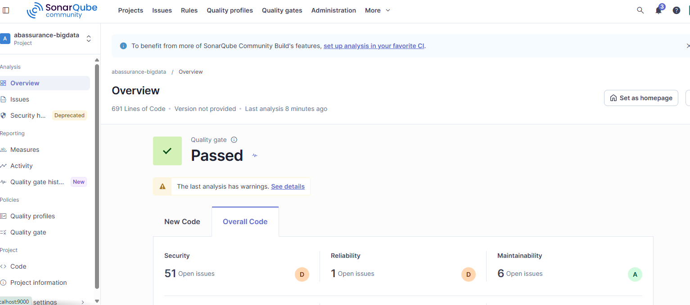

## Les modèles conceptuels de données (MCD) d'AssurePlus et AbAssurance

### AbAssurance


> AB_CLIENT ( ab_client_id, ab_nom, ab_prenom, ab_date_naissance, ab_email, ab_telephone, ab_adresse, ab_code_postal, ab_num_fiscal, ab_date_creation, ab_statut_client )
> Le champ ab_client_id constitue la clé primaire de la table. C'était déjà un identifiant de l'entité AB_CLIENT.
> Les champs ab_nom, ab_prenom, ab_date_naissance, ab_email, ab_telephone, ab_adresse, ab_code_postal, ab_num_fiscal, ab_date_creation et ab_statut_client étaient déjà de simples attributs de l'entité AB_CLIENT.
> AB_CONTRAT ( ab_policy_number, ab_type_assurance, ab_date_debut, ab_date_fin, ab_prime_annuelle, ab_statut_contrat, ab_agence_id, #ab_client_id )
> Le champ ab_policy_number constitue la clé primaire de la table. C'était déjà un identifiant de l'entité AB_CONTRAT.
> Les champs ab_type_assurance, ab_date_debut, ab_date_fin, ab_prime_annuelle, ab_statut_contrat et ab_agence_id étaient déjà de simples attributs de l'entité AB_CONTRAT.
> Le champ ab_client_id est une clé étrangère. Il a migré par l'association de dépendance fonctionnelle SOUSCRIRE à partir de l'entité AB_CLIENT en perdant son caractère identifiant.
> AB_PAIEMENT ( ab_payment_id, ab_date_paiement, ab_montant, ab_mode_paiement, #ab_policy_number )
> Le champ ab_payment_id constitue la clé primaire de la table. C'était déjà un identifiant de l'entité AB_PAIEMENT.
> Les champs ab_date_paiement, ab_montant, ab_mode_paiement étaient déjà de simples attributs de l'entité AB_PAIEMENT.
> Le champ ab_policy_number est une clé étrangère. Il a migré par l'association de dépendance fonctionnelle REGLER à partir de l'entité AB_CONTRAT en perdant son caractère identifiant.
> AB_SINISTRE ( ab_claim_id, ab_date_sinistre, ab_montant_estime, ab_statut_sinistre, ab_description, #ab_policy_number )
> Le champ ab_claim_id constitue la clé primaire de la table. C'était déjà un identifiant de l'entité AB_SINISTRE.
> Les champs ab_date_sinistre, ab_montant_estime, ab_statut_sinistre, ab_description étaient déjà de simples attributs de l'entité AB_SINISTRE.
> Le champ ab_policy_number est une clé étrangère. Il a migré par l'association de dépendance fonctionnelle DECLARER à partir de l'entité AB_CONTRAT en perdant son caractère identifiant.

### AssurePlus


> AP_CLAIMS ( AP_SINISTRE_NUM, AP_INCIDENT_DATE, AP_ESTIMATED_AMOUNT, AP_CLAIM_STATUS, AP_CLAIM_COMMENT, AP_FRAUD_SCORE, AP_CONTRACT_REF 1, #AP_CONTRACT_REF 2 )
> Le champ AP_SINISTRE_NUM constitue la clé primaire de la table. C'était déjà un identifiant de l'entité AP_CLAIMS.
> Les champs AP_INCIDENT_DATE, AP_ESTIMATED_AMOUNT, AP_CLAIM_STATUS, AP_CLAIM_COMMENT, AP_FRAUD_SCORE et AP_CONTRACT_REF 1 étaient déjà de simples attributs de l'entité AP_CLAIMS.
> Le champ AP_CONTRACT_REF 2 est une clé étrangère. Il a migré par l'association de dépendance fonctionnelle DECLARER à partir de l'entité AP_CONTRACTS en perdant son caractère identifiant.
> AP_CONTRACTS ( AP_CONTRACT_REF, AP_PRODUCT_CODE, AP_START_DATE, AP_END_DATE, AP_MONTHLY_PREMIUM, AP_CONTRACT_STATE, AP_BROKER_CODE, AP_USER_ID 1, #AP_USER_ID 2 )
> Le champ AP_CONTRACT_REF constitue la clé primaire de la table. C'était déjà un identifiant de l'entité AP_CONTRACTS.
> Les champs AP_PRODUCT_CODE, AP_START_DATE, AP_END_DATE, AP_MONTHLY_PREMIUM, AP_CONTRACT_STATE, AP_BROKER_CODE et AP_USER_ID 1 étaient déjà de simples attributs de l'entité AP_CONTRACTS.
> Le champ AP_USER_ID 2 est une clé étrangère. Il a migré par l'association de dépendance fonctionnelle SOUSCRIRE à partir de l'entité AP_USERS en perdant son caractère identifiant.
> AP_PAYMENTS ( AP_PAYMENT_REF, AP_PAYMENT_DATETIME, AP_AMOUNT_PAID, AP_PAYMENT_CHANNEL, AP_TRANSACTION_STATUS, AP_CONTRACT_REF 1, #AP_CONTRACT_REF 2 )
> Le champ AP_PAYMENT_REF constitue la clé primaire de la table. C'était déjà un identifiant de l'entité AP_PAYMENTS.
> Les champs AP_PAYMENT_DATETIME, AP_AMOUNT_PAID, AP_PAYMENT_CHANNEL, AP_TRANSACTION_STATUS et AP_CONTRACT_REF 1 étaient déjà de simples attributs de l'entité AP_PAYMENTS.
> Le champ AP_CONTRACT_REF 2 est une clé étrangère. Il a migré par l'association de dépendance fonctionnelle REGLER à partir de l'entité AP_CONTRACTS en perdant son caractère identifiant.
> AP_USERS ( AP_USER_ID, AP_FULL_NAME, AP_BIRTH_DATE, AP_MAIL_ADDRESS, AP_PHONE_NUMBER, AP_STREET_ADDRESS, AP_ZIP_CODE, AP_CREATED_AT, AP_CUSTOMER_STATUS, AP_LOYALTY_SCORE )
> Le champ AP_USER_ID constitue la clé primaire de la table. C'était déjà un identifiant de l'entité AP_USERS.
> Les champs AP_FULL_NAME, AP_BIRTH_DATE, AP_MAIL_ADDRESS, AP_PHONE_NUMBER, AP_STREET_ADDRESS, AP_ZIP_CODE, AP_CREATED_AT, AP_CUSTOMER_STATUS et AP_LOYALTY_SCORE étaient déjà de simples attributs de l'entité AP_USERS.

### Mapping des deux modèles

Le mapping complet est dans le fichier `mapping_donnees.md`.

Exemple de mapping des données :

| Base AbAssurance    | Base AssurePlus       | Modèle cible     |
| ------------------- | --------------------- | ---------------- |
| `AB_CLIENT`         | `AP_USERS`            | `CLIENT`         |
| `AB_CONTRAT`        | `AP_CONTRACTS`        | `CONTRAT`        |
| `AB_SINISTRE`       | `AP_CLAIMS`           | `SINISTRE`       |
| `AB_PAIEMENT`       | `AP_PAYMENTS`         | `PAIEMENT`       |
| `ab_nom`            | `AP_FULL_NAME`        | `nom_prenom`     |
| `ab_email`          | `AP_MAIL_ADDRESS`     | `email`          |
| `ab_telephone`      | `AP_PHONE_NUMBER`     | `telephone`      |
| `ab_date_naissance` | `AP_BIRTH_DATE`       | `date_naissance` |
| `ab_date_debut`     | `AP_START_DATE`       | `date_debut`     |
| `ab_date_fin`       | `AP_END_DATE`         | `date_fin`       |
| `ab_montant_estime` | `AP_ESTIMATED_AMOUNT` | `montant_estime` |
| `ab_date_paiement`  | `AP_PAYMENT_DATETIME` | `date_paiement`  |
| `ab_montant`        | `AP_AMOUNT_PAID`      | `montant`        |

### Justification du modèle cible

Pour construire le modèle cible, je me suis basé sur les deux modèles de données fournis en annexe, AbAssurance et AssurePlus. Comme les deux bases contiennent des informations qui correspondent aux mêmes éléments métier, j'ai regroupé les entités similaires afin d'obtenir un modèle commun.

Par exemple, AB_CLIENT et AP_USERS ont été regroupées dans l'entité CLIENT. De la même manière, AB_CONTRAT et AP_CONTRACTS correspondent à CONTRAT, AB_SINISTRE et AP_CLAIMS à SINISTRE, et AB_PAIEMENT et AP_PAYMENTS à PAIEMENT.

Pour les attributs, j'ai regroupé ceux qui étaient communs aux deux systèmes et j'ai conservé les attributs spécifiques lorsqu'ils apportaient des informations supplémentaires. Les différentes relations entre les entités ont également été conservées afin de garder la logique métier présente dans les deux bases de données.

### MCD final après fusion


> CLIENT ( client_id, nom, prenom, date_naissance, email, téléphone, adresse, code_postal, num_fiscal, date_creation, statut_client, loyalty_score )
> Le champ client_id constitue la clé primaire de la table. C'était déjà un identifiant de l'entité CLIENT.
> Les champs nom, prenom, date_naissance, email, téléphone, adresse, code_postal, num_fiscal, date_creation, statut_client et loyalty_score étaient déjà de simples attributs de l'entité CLIENT.
> CONTRAT ( contrat_id, type_assurance, code_produit, date_debut, date_fin, prime_annuelle, prime_mensuelle, statut_contrat, etat_contrat, agence_id, code_courtier, client_id 1, #client_id 2 )
> Le champ contrat_id constitue la clé primaire de la table. C'était déjà un identifiant de l'entité CONTRAT.
> Les champs type_assurance, code_produit, date_debut, date_fin, prime_annuelle, prime_mensuelle, statut_contrat, etat_contrat, agence_id, code_courtier et client_id 1 étaient déjà de simples attributs de l'entité CONTRAT.
> Le champ client_id 2 est une clé étrangère. Il a migré par l'association de dépendance fonctionnelle SOUSCRIRE à partir de l'entité CLIENT en perdant son caractère identifiant.
> PAIEMENT ( paiement_id, date_paiement, montant, mode_paiement, statut_transaction, contrat_id 1, #contrat_id 2 )
> Le champ paiement_id constitue la clé primaire de la table. C'était déjà un identifiant de l'entité PAIEMENT.
> Les champs date_paiement, montant, mode_paiement, statut_transaction et contrat_id 1 étaient déjà de simples attributs de l'entité PAIEMENT.
> Le champ contrat_id 2 est une clé étrangère. Il a migré par l'association de dépendance fonctionnelle REGLER à partir de l'entité CONTRAT en perdant son caractère identifiant.
> SINISTRE ( sinistre_id, date_sinistre, montant_estime, statut_sinistre, description, fraud_score, contrat_id 1, #contrat_id 2 )
> Le champ sinistre_id constitue la clé primaire de la table. C'était déjà un identifiant de l'entité SINISTRE.
> Les champs date_sinistre, montant_estime, statut_sinistre, description, fraud_score et contrat_id 1 étaient déjà de simples attributs de l'entité SINISTRE.
> Le champ contrat_id 2 est une clé étrangère. Il a migré par l'association de dépendance fonctionnelle DECLARER à partir de l'entité CONTRAT en perdant son caractère identifiant.

### Relations entre les entités

Le modèle de données final comporte trois relations principales :

* CLIENT — SOUSCRIRE — CONTRAT : relation 1:N. Un client peut souscrire plusieurs contrats, tandis qu'un contrat est rattaché à un seul client.
* CONTRAT — DECLARER — SINISTRE : relation 1:N. Un contrat peut être associé à plusieurs sinistres, tandis qu'un sinistre est rattaché à un seul contrat.
* CONTRAT — REGLER — PAIEMENT : relation 1:N. Un contrat peut être associé à plusieurs paiements, tandis qu'un paiement est rattaché à un seul contrat.

### Évolutions du modèle à l'implémentation
 
Le MCD final ci-dessus est le modèle conçu au départ. Deux choix faits pendant l'implémentation s'en écartent :
 
* **`nom` et `prenom` sont fusionnés en un seul champ `nom_prenom`.** AssurePlus ne fournit qu'un nom complet (`AP_FULL_NAME`), alors qu'AbAssurance a deux champs séparés : le champ commun est donc le nom complet (voir « Fusionner les données »).
* **Les identifiants des clients et des contrats sont des textes préfixés** (`AB-` ou `AP-`, par exemple `AB-000001`), pour qu'un identifiant ne puisse pas être le même dans les deux sources (voir « Fusionner les données », décision sur `client_id`).


## Choix des outils

### Talend → Talaxie

Talend Open Studio ayant été discontinué par Qlik le 31/01/2024 (plus de distribution officielle gratuite), le projet utilise Talaxie, fork communautaire open source (licence Apache 2.0) assurant la continuité fonctionnelle de l'outil, avec pleine compatibilité des jobs Talend existants.

Preuve de fonctionnement du job de test :

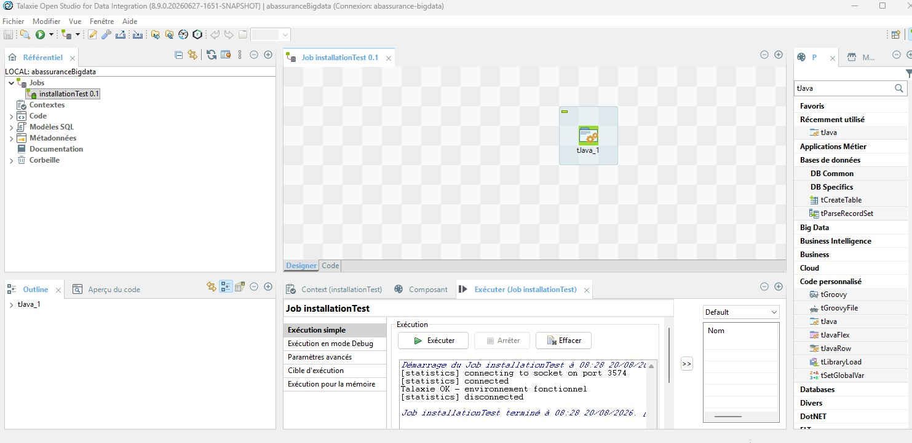

### Kafka et Hadoop

Afin de faciliter l'installation, l'environnement a été mis en place via un container Docker (fichier `docker-compose.yaml` avec les images de Kafka et Hadoop).

Preuve de fonctionnement — containers up :

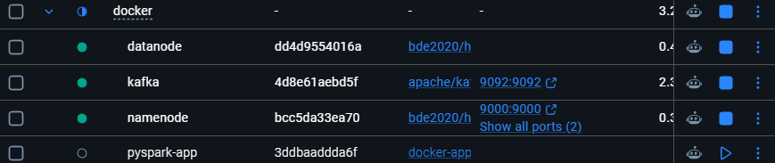

Preuve de fonctionnement — Hadoop accessible :

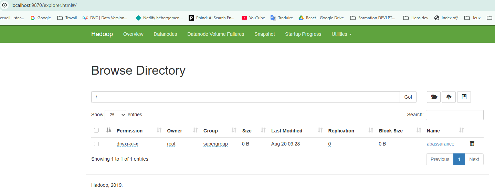

Le dossier nommé `abassurance` créé via la commande de mkdir HDFS est bien visible, confirmant que le NameNode fonctionne correctement.

Preuve de fonctionnement — flux Kafka (production/consommation d'un message) :

```shell
# Terminal 1 — producteur
(.venv) PS C:\xampp\htdocs\Projets\abassurance-bigdata\Docker> docker exec -it kafka /opt/kafka/bin/kafka-console-producer.sh --topic test-abassurance --bootstrap-server localhost:9092
>test_sinistre_001
>test_sinistre_002

# Terminal 2 — consommateur
(.venv) PS C:\xampp\htdocs\Projets\abassurance-bigdata> docker exec -it kafka /opt/kafka/bin/kafka-console-consumer.sh --topic test-abassurance --bootstrap-server localhost:9092 --from-beginning
test_sinistre_001
test_sinistre_002
```

### Test Spark ↔ Hadoop

Création d'un script pour tester la connexion Spark ↔ Hadoop :

* Il définit l'adresse de l'entrepôt HDFS (`hdfs://namenode:9000`) — comme une adresse postale que Spark va utiliser pour trouver le service Hadoop sur le réseau Docker.
* Il démarre Spark en lui disant « par défaut, va stocker/chercher tes fichiers sur cet entrepôt HDFS » (la ligne `spark.hadoop.fs.defaultFS`).
* Il écrit un petit tableau de données factices (2 clients) au format Parquet sur HDFS.
* Il relit ce même fichier depuis HDFS et l'affiche — si ça marche, ça prouve que Spark et Hadoop communiquent bien dans les deux sens.

Résultat du test :

```shell
(.venv) PS C:\xampp\htdocs\Projets\abassurance-bigdata\Docker> docker compose run --rm app python test_hadoop_spark.py
[+] Running 3/3
 ✔ Container namenode Running
 ✔ Container kafka    Running
 ✔ Container datanode Running
Container docker-app-run-dc0ee55e32a1 Creating
Container docker-app-run-dc0ee55e32a1 Created
WARNING: Using incubator modules: jdk.incubator.vector
Using Spark's default log4j profile: org/apache/spark/log4j2-defaults.properties
Setting default log level to "WARN".
26/08/20 08:02:51 WARN NativeCodeLoader: Unable to load native-hadoop library for your platform... using builtin-java classes where applicable
>>> Ecriture d'un DataFrame de test sur HDFS...
>>> Ecriture terminee sur hdfs://namenode:9000/abassurance/test/spark_test.parquet
>>> Relecture depuis HDFS...
+---+-------------+-------+
| id|   client_ref| statut|
+---+-------------+-------+
|  2|AB_CLIENT_002|resilie|
|  1|AB_CLIENT_001|  actif|
+---+-------------+-------+

>>> TEST SPARK <-> HADOOP REUSSI
```

## Problèmes rencontrés & résolutions

Cette section documente les principaux incidents rencontrés lors de la mise en place de l'environnement, la démarche de diagnostic suivie, et la correction apportée — dans une logique d'amélioration continue.

### 1. Talaxie : caractères accentués dans le chemin d'installation

**Symptôme** : erreur au démarrage `Cannot read the array length because "jetFiles" is null`.

**Diagnostic** : le moteur Eclipse/Equinox sur lequel repose Talaxie ne supporte pas les caractères accentués dans le chemin d'installation lors de l'énumération de ses plugins internes.

**Cause identifiée** : le dossier d'installation contenait un accent (`E:\Important Aurélie\...`).

**Correction** : déplacement de l'installation vers un chemin sans accent ni espace (`C:\Talaxie\`).

### 2. Talaxie : incompatibilité avec le JDK système (Java 25)

**Symptôme** : `Exception in thread "org.talend.sdk.component.studio.ProcessManager-server"` puis `InaccessibleObjectException: Unable to make java.lang.invoke.MethodHandles$Lookup(...) accessible`.

**Diagnostic** : le « Component Server » interne de Talaxie utilise la réflexion Java pour charger dynamiquement ses composants. Le système de modules strict introduit par les versions récentes de Java (25) bloque ces accès par défaut.

**Correction** :

* Installation d'un JDK 21 (Eclipse Temurin) dédié, sans modifier le JDK système.
* Configuration du fichier `.ini` de Talaxie pour forcer l'utilisation de ce JDK 21 via l'option `-vm`.
* Ajout d'options `--add-opens` (`java.lang`, `java.lang.invoke`, `java.util`, `java.io`, `java.net`, `sun.nio.ch`) dans les `-vmargs` du fichier `.ini`, pour autoriser explicitement les accès par réflexion nécessaires au moteur de génération de code (JET).

### 3. Talaxie : build Maven en mode hors-ligne

**Symptôme** : `Cannot access central (https://repo1.maven.org/maven2/) in offline mode`, lors de l'exécution d'un job.

**Diagnostic** : Talaxie utilise Maven en interne pour compiler chaque job en code Java exécutable. Le mode « Work offline » de Maven, activé par défaut, empêchait le téléchargement du plugin `maven-jar-plugin` nécessaire à la compilation.

**Correction** : désactivation du mode hors-ligne dans **Window → Preferences → Maven → décocher « Work offline »**.

### 4. Hadoop : namenode et datanode ne démarrent pas dans Docker

**Symptôme** : `Invalid URI for NameNode address (check fs.defaultFS): file:/// has no authority`, puis le datanode échoue avec `No services to connect, missing NameNode address`.

**Diagnostic** : l'image Docker officielle `apache/hadoop:3` démarre avec une configuration minimale par défaut (`fs.defaultFS=file:///`), sans configuration réseau HDFS. Le namenode refuse donc de démarrer, et le datanode n'a personne à qui se connecter.

**Correction** : remplacement par les images `bde2020/hadoop-namenode` et `bde2020/hadoop-datanode`, qui acceptent une configuration simplifiée par variables d'environnement (`CORE_CONF_fs_defaultFS=hdfs://namenode:9000`), sans avoir à écrire manuellement les fichiers XML de configuration Hadoop.

### 5. Docker : fichier introuvable dans le conteneur après ajout

**Symptôme** : `python: can't open file '/app/test_hadoop_spark.py': [Errno 2] No such file or directory`, alors que le fichier existait bien sur le poste.

**Diagnostic** : l'image Docker n'est pas synchronisée en continu avec le système de fichiers local — elle capture un instantané des fichiers uniquement au moment du `docker build` (instruction `COPY . .`). Le fichier avait été ajouté après le dernier build.

**Correction** : rebuild explicite de l'image (`docker compose build app`) après chaque ajout de fichier nécessaire à l'exécution.

## Création d'un dataset

La création du dataset servira à la fois pour tester le pipeline et pour illustrer concrètement les bonnes pratiques de data cleaning. Les données sont générées avec Faker (voir README pour les commandes d'installation et de lancement de `generate_dataset.py`).

### Inventaire des bases de données

**Structure de tableau proposée** — une ligne par table, groupée par système source :

| Système source | Table | Nb colonnes | Clé primaire | Clés étrangères / relations | Volume réel estimé (prod) | Volume jeu de dev |
| --- | --- | --- | --- | --- | --- | --- |
| AbAssurance (Oracle) | AB_CLIENT | 10 | AB_CLIENT_ID | — (entité racine) | ~12 M lignes | 200 lignes |
| AbAssurance (Oracle) | AB_CONTRAT | 7 | AB_POLICY_NUMBER | AB_CLIENT_ID → AB_CLIENT | à estimer (~1,3 contrat/client) | 300 lignes |
| AbAssurance (Oracle) | AB_SINISTRE | 5 | AB_CLAIM_ID | AB_POLICY_NUMBER → AB_CONTRAT | à estimer | 62 lignes |
| AbAssurance (Oracle) | AB_PAIEMENT | 5 | AB_PAYMENT_ID | AB_POLICY_NUMBER → AB_CONTRAT | à estimer | 1 051 lignes |
| AssurePlus (SQL Server) | AP_USERS | 10 | AP_USER_ID | — (entité racine) | ~5 M lignes | 100 lignes |
| AssurePlus (SQL Server) | AP_CONTRACTS | 8 | AP_CONTRACT_REF | AP_USER_ID → AP_USERS | à estimer | 148 lignes |
| AssurePlus (SQL Server) | AP_CLAIMS | 7 | AP_SINISTRE_NUM | AP_CONTRACT_REF → AP_CONTRACTS | à estimer | 38 lignes |
| AssurePlus (SQL Server) | AP_PAYMENTS | 6 | AP_PAYMENT_REF | AP_CONTRACT_REF → AP_CONTRACTS | à estimer | 527 lignes |

Les volumes de production sont estimés à partir de la présentation de l'entreprise. Les tables filles (contrats, sinistres, paiements) sont estimées par un ratio moyen [x contrats/client], en l'absence de données réelles disponibles.

Les relations entre les tables sont définies dans la section « Les modèles conceptuels de données (MCD) d'AssurePlus et AbAssurance ».

## US 1.2 Extraction Oracle

Les données du dataset ont été générées par un script avec Faker afin de simuler une extraction.

Étapes de création du job dans Talaxie :

1. **Lire le CSV source (`tFileInputDelimited`)** : création d'un nouveau job `extraction_ab_client` dans Talaxie (correspond à la branche `feature/US1.2-extraction-oracle`). Glisser un composant `tFileInputDelimited` depuis la palette, et le pointer vers le fichier `ab_client.csv` généré par `generate_dataset.py`. Définir le schéma des colonnes (`ab_client_id`, `ab_nom`, `ab_prenom`, etc.) manuellement.

2. **Écrire le résultat standardisé (`tFileOutputDelimited`)** : un `tFileOutputDelimited` écrit le résultat standardisé dans `output/ab_assurance_extract_talaxie/ab_assurance_extract_client.csv`. Relier `tFileInputDelimited_1` vers ce composant (clic droit → Ligne → Main → clic sur `tFileOutputDelimited`). Définir le chemin de sortie en zone de staging. Cocher « Inclure l'en-tête » pour que le fichier garde les noms de colonnes `ab_*` — utile pour la lisibilité et pour que l'US suivante (nettoyage) puisse relire ce fichier facilement. Vérifier que l'encodage est bien UTF-8.

3. **Exécuter et valider** : exécution du job, puis ouverture du fichier généré pour confirmer le nombre de lignes pour chaque table extraite, avec les accents corrects.

Capture d'écran des jobs :


## US 1.3 Extraction SQL Server

Le processus reste le même en utilisant les CSV d'AssurePlus.

Capture d'écran des jobs :


Talaxie a repéré des anomalies dans les formats de date de l'export CSV de la table `users`. Le format était `jj/mm/YYYY` au lieu de `YYYY-mm-dd`.

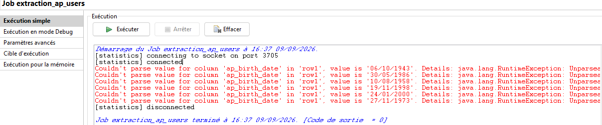

## US 1.4 Contrôle du nombre d'enregistrements

Le journal d'extraction se trouve dans `/data/logs/controle_extraction.csv`.

Pour AssurePlus, la table Users contient une anomalie : six lignes ont été ignorées à cause du format de date non conforme.

Pour que l'extraction soit sans perte, j'ai modifié le schéma : pour le champ `ap_birth_date`, j'ai mis le type `string` au lieu de `date`, avec un modèle `YYYY-mm-dd`.

Après avoir relancé le contrôle, le résultat est le suivant :

```shell
2026-09-11 10:37:50,AssurePlus,AP_USERS,100,100,0,OK
```

## US 2.1 Nettoyage des données

### Règle de nettoyage

Les règles sont définies dans le fichier [`regles_nettoyage.md`](./regles_nettoyage.md).

### Configuration de Talaxie pour le nettoyage de données

#### Doublons

1. Configurer tUniqRow sur ab_client_id
Dans le job nettoyage_ab_client, placer un tUniqRow juste après le tFileInputDelimited.
Dans ses paramètres, cocher uniquement ab_client_id comme clé de comparaison (les autres colonnes restent décochées) — c'est la clé primaire, deux lignes avec le même ab_client_id sont par définition un doublon technique, quel que soit le contenu des autres champs.

2. Brancher les deux sorties (Uniques / Doublons)
tUniqRow expose deux sorties distinctes visibles quand on tire une ligne depuis le composant : 'Uniques' (lignes gardées, une par clé) et 'Doublons' (lignes rejetées).
Relier 'Uniques' vers la suite du pipeline (le futur tMap), et 'Doublons' vers un tFileOutputDelimited séparé : data/rejects/oracle/ab_client_doublons.csv.
Rien ne doit disparaître sans laisser de trace, même les doublons rejetés.

3. Tester avec un doublon injecté volontairement
Sur les jeux de données générés par Faker, il est probable qu'il n'y ait aucun vrai doublon (Faker génère des ID séquentiels propres).
Pour valider concrètement que tUniqRow fonctionne (et pas juste 'zéro doublon car aucun test réel'), il faut dupliquer manuellement une ligne dans une copie de test du CSV, relancer le job sur ce fichier de test, et vérifier que le doublon atterrit bien dans ab_client_doublons.csv et pas dans le fichier propre.

 ---

Exemple avec le nettoyage de la table client pour abassurance avec l'ajout de 2 doublons (Id 1 et 5) afin de s'assurer que le nettoyage fonctionne.
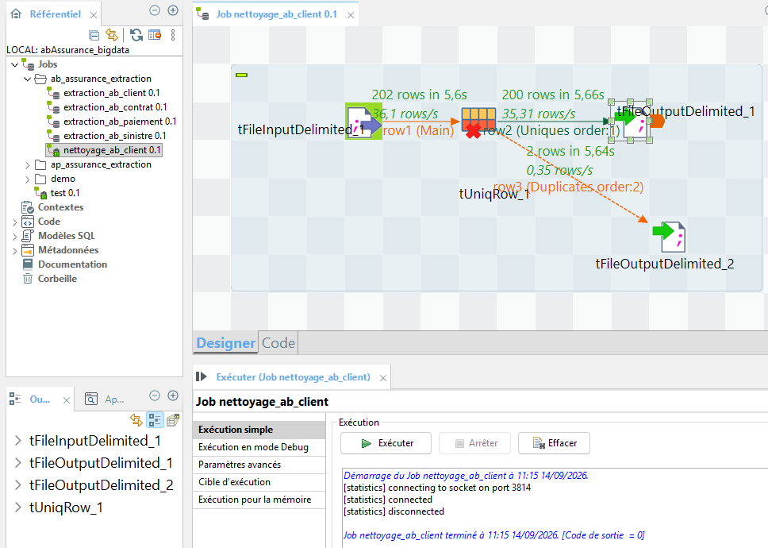

Les fichiers d'extraction sont dans ./data/output/ab_assurance_extract_talaxie/ab_assurance_nettoye/ab_assurance_extract_client_clean
Et pour l'extraction des doublons : ./data\output\doublons\ab_client_doublons.

Pour l'exemple, j'ai fait de même pour AssurePlus. Il y a deux doublons, un pour la table users (ID 1) et l'autre pour la table contracts (ID : AP-AP-000147).

#### Routine data Cleaning

Afin de nettoyer les anomalies des données : format de date, format d'email, téléphone manquant.

J'utilise un composant tJavaRow pour appliquer ma routine Java à chaque ligne. La routine centralise les règles de nettoyage. Une fois les données nettoyées, je passe par tUniqRow pour supprimer les doublons, puis j'exporte le résultat dans un nouveau fichier CSV.

Je développe le code routine afin de nettoyer les données.

```java
package routines;

import java.text.SimpleDateFormat;
import java.util.Date;

public class DataCleaning {

/**
     * Nettoie une chaîne de caractères.
     * Supprime les espaces inutiles.
     * Transforme une valeur vide en null.
     */
    public static String nettoyerTexte(String valeur) {

        if (valeur == null) {
            return null;
        }

        valeur = valeur.trim();

        if (valeur.isEmpty()) {
            return null;
        }

        return valeur;
    }

    /**
     * Nettoie une adresse email.
     * Vérifie qu'elle contient bien un @ et un point.
     */
    public static String nettoyerEmail(String email) {

        if (email == null) {
            return null;
        }

        email = email.trim().toLowerCase();

        // Email vide
        if (email.isEmpty()) {
            return null;
        }

        // Correction d'un email mal écrit
        if (email.contains("_at_")) {
            email = email.replace("_at_", "@");
        }

        // Vérification simple de l'email
        if (!email.contains("@") || !email.contains(".")) {
            return null;
        }

        return email;
    }

    /**
     * Nettoie un numéro de téléphone.
     * Supprime les espaces au début et à la fin.
     * Une valeur vide devient null.
     */
    public static String nettoyerTelephone(String telephone) {

        if (telephone == null) {
            return null;
        }

        telephone = telephone.trim();

        if (telephone.isEmpty()) {
            return null;
        }

        return telephone;
    }


    /**
     * Nettoie et uniformise une date, avec un format de sortie choisi.
     *
     * Formats d'entrée acceptés :
     * - yyyy-MM-dd
     * - dd/MM/yyyy
     * - yyyy-MM-dd HH:mm:ss
     *
     * @param date la date brute à nettoyer
     * @param formatSortie le format souhaité en sortie (ex: "yyyy-MM-dd" ou "yyyy-MM-dd HH:mm:ss")
     */
    public static String normaliserDate(String date, String formatSortie) {

        if (date == null) {
            return null;
        }

        date = date.trim();

        if (date.isEmpty()) {
            return null;
        }

        String[] formats = {
            "yyyy-MM-dd HH:mm:ss",
            "yyyy-MM-dd",
            "dd/MM/yyyy"
        };

        for (String format : formats) {

            try {

                SimpleDateFormat formatEntree =
                    new SimpleDateFormat(format);

                formatEntree.setLenient(false);

                Date dateConvertie =
                    formatEntree.parse(date);

                SimpleDateFormat formatSortieFinal =
                    new SimpleDateFormat(formatSortie);

                return formatSortieFinal.format(dateConvertie);

            } catch (Exception e) {
                // Format suivant testé automatiquement
            }
        }

        return null;
    }


    /**
     * Nettoie un montant.
     * Une valeur vide ou incorrecte devient null.
     */
    public static Double nettoyerMontant(String montant) {

        if (montant == null) {
            return null;
        }

        montant = montant.trim();

        if (montant.isEmpty()) {
            return null;
        }

        try {

            return Double.parseDouble(montant);

        } catch (NumberFormatException e) {

            return null;
        }
    }

    
    
}

```

Dans le code de tJavaRow, j'appelle pour les champs la méthode concernée.

```java
// Code générer selon le schéma client de AbAssurance
output_row.AB_CLIENT_ID = input_row.AB_CLIENT_ID;

output_row.AB_NOM =
    DataCleaning.nettoyerTexte(input_row.AB_NOM);

output_row.AB_PRENOM =
    DataCleaning.nettoyerTexte(input_row.AB_PRENOM);

output_row.AB_DATE_NAISSANCE =
    DataCleaning.normaliserDate(input_row.AB_DATE_NAISSANCE);

output_row.AB_EMAIL =
    DataCleaning.nettoyerEmail(input_row.AB_EMAIL);

output_row.AB_TELEPHONE =
    DataCleaning.nettoyerTelephone(input_row.AB_TELEPHONE);

output_row.AB_ADRESSE =
    DataCleaning.nettoyerTexte(input_row.AB_ADRESSE);

output_row.AB_CODE_POSTAL =
    DataCleaning.nettoyerTexte(input_row.AB_CODE_POSTAL);

output_row.AB_NUM_FISCAL =
    DataCleaning.nettoyerTexte(input_row.AB_NUM_FISCAL);

output_row.AB_DATE_CREATION =
DataCleaning.normaliserDate(input_row.AB_DATE_CREATION, "yyyy-MM-dd HH:mm:ss");

output_row.AB_STATUT_CLIENT =
    DataCleaning.nettoyerTexte(input_row.AB_STATUT_CLIENT);
```

```java
//Code généré selon les schémas d'entrée et de sortie pour AssurePlus
output_row.ap_user_id = input_row.ap_user_id;
output_row.ap_full_name = DataCleaning.nettoyerTexte(input_row.ap_full_name);

output_row.ap_birth_date = DataCleaning.normaliserDate(input_row.ap_birth_date);

output_row.ap_mail_address = DataCleaning.nettoyerEmail(input_row.ap_mail_address);

output_row.ap_phone_number = DataCleaning.nettoyerTelephone(input_row.ap_phone_number);

output_row.ap_street_address =  DataCleaning.nettoyerTexte(input_row.ap_street_address);

output_row.ap_zip_code = DataCleaning.nettoyerTexte(input_row.ap_zip_code);

output_row.ap_created_at = DataCleaning.normaliserDate(input_row.ap_created_at, "yyyy-MM-dd HH:mm:ss");

output_row.ap_customer_status = DataCleaning.nettoyerTexte(input_row.ap_customer_status);

output_row.ap_loyalty_score = input_row.ap_loyalty_score;

```

Le rapport d'anomalie confirme que les seules lignes rejetées sont les doublons. Les données incorrectes ont été corrigés.

## US 2.2 Transformation au format commun : fusionner les données

L'objectif est de transformer les données nettoyées AB_CLIENT (Oracle) et AP_USERS (SQL Server) vers le schéma cible commun client_commun, avec détection et fusion des doublons inter-systèmes (même client existant dans les deux bases)

Étapes de construction

1. Lecture des sources nettoyées : deux tFileInputDelimited, un par système, pointant vers les sorties d'US2.1 (ab_client_cleaned.csv, ap_users_cleaned.csv) — pas les fichiers bruts extraits.

2. Mapping vers le schéma commun : implémenté en tJavaRow (et non tMap, suite à une instabilité du tMap sur cette version de Talaxie — schéma/expressions réinitialisés silencieusement au clic sur OK). Un tJavaRow par source, assignant explicitement les 10 champs du schéma cible (client_id, nom_prenom, date_naissance, email, téléphone, adresse, code_postal, num_fiscal, date_creation, statut_client, loyalty_score).

3. Fusion des deux flux : tUnite_1, avec le flux AbAssurance connecté en premier (l'ordre conditionne la priorité lors du dédoublonnage à l'étape 5).

4. Détection des doublons inter-systèmes : tUniqRow sur la clé email, appliqué uniquement aux lignes avec email présent.

5. Une sortie pour les données. Pour les clients, il y a deux sorties, une pour les données correctes et sans doublons et une autre pour les doublons.

6. Journalisation : tJava déclenché en OnComponentOk, écrivant une ligne récapitulative dans journal_transformation.csv.

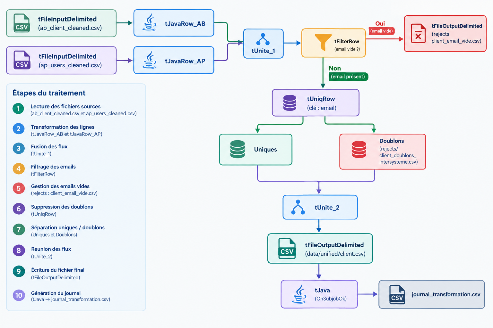

Le canvas Talaxie :

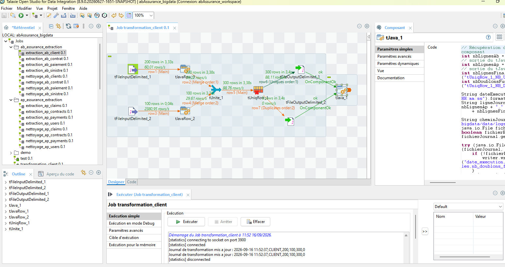

### Bugs rencontrés et corrections

tMap : schéma de sortie vidé au clic sur OK Version Talaxie snapshot (V8.9.0-SNAPSHOT) instable sur ce composant.
Diagnostic : Expressions perdues silencieusement sans message d'erreur.
Correction : Remplacement du tMap par un tJavaRow pour toute la transformation.

Décision client_id : String ("AB-"/"AP-") vs Integer.
Diagnostic : Le schéma officiel typait client_id en Integer, incompatible avec un préfixe texte.
Correction : Modification du type de client_id dans le schéma commun (Métadonnées) de Integer vers String, propagée aux jobs.

## US 3.1 — Créer les topics Kafka

### Objectif

Préparer dans Kafka un « canal » par table, dans lequel Talaxie publiera les données transformées (US 3.2) et que Spark lira en continu (US 4.2).

Un topic Kafka fonctionne comme une chaîne de télévision dédiée : Talaxie diffuse sur la chaîne « clients », et Spark regarde cette chaîne en permanence pour enregistrer tout ce qui y passe.

### Réalisation

Les topics sont créés par le script `Docker/init-environment.ps1`, à lancer une fois après le premier démarrage de la plateforme :

```powershell
.\Docker\init-environment.ps1
```

| Topic | Contenu |
| --- | --- |
| `abassurance.clients.v1` | Clients fusionnés AbAssurance / AssurePlus |
| `abassurance.contrats.v1` | Contrats |
| `abassurance.paiements.v1` | Paiements |
| `abassurance.sinistres.v1` | Sinistres |

Choix effectués :

* **Nommage** `abassurance.<table>.v1` : le préfixe identifie le projet, le suffixe `v1` permettra de créer une nouvelle version d'un topic si le format des messages change, sans casser les programmes qui lisent l'ancienne.
* **Une partition et un facteur de réplication de 1** : le volume de données est faible et il n'y a qu'un seul broker Kafka. En production, on augmenterait les deux pour répartir la charge et ne rien perdre en cas de panne d'un serveur.
* **Création automatique désactivée** (`KAFKA_AUTO_CREATE_TOPICS_ENABLE: "false"` dans le `docker-compose.yaml`) : une faute de frappe dans un nom de topic provoque une erreur visible, au lieu de créer en silence un topic vide que personne ne lit.
* **Script relançable** : l'option `--if-not-exists` évite une erreur si les topics existent déjà. Le script attend aussi que Kafka soit prêt (20 essais espacés de 5 secondes) au lieu d'un délai fixe.

Le même script crée l'arborescence HDFS utilisée par le streaming (`/data/kafka/<table>`, `/data/checkpoints/<table>`, `/data/clean`).

### Vérification

```powershell
docker exec kafka /opt/kafka/bin/kafka-topics.sh --list --bootstrap-server localhost:9092
```

Les topics et leurs messages sont aussi visibles dans Kafka UI (http://localhost:8080).

## US 3.2 — Publication des données transformées vers Kafka

1. Télécharger le composant Kafka dans Talaxie. Il permet de réutiliser cette config Kafka dans tous les jobs sans la reconfigurer à chaque fois. Appelé ce composant via un tLibraryLoad.
2. Comme tKafkaOutput n'existe pas dans Talaxie, j'utilise le client Kafka Java directement (KafkaProducer) dans tJavaRow. Je crée un nouveau job avec le tLibraryLoad -> tInputDelimited->tJavaFlex->tOutputDelimited à la fin de chacun des jobs afin d'avoir un fichier et pouvoir comparer le nombre de lignes avec le nombre de messages dans Kafka pour chaque.
3. Format du message : comme évoqué dans la doc, il faut décider maintenant JSON ou Avro. Vu le contexte académique/projet, je pars sur JSON simple pour cette US — plus rapide à mettre en place, suffisant pour valider le flux.
4. Vérification du non-perte de données : compter les lignes en entrée (via tJavaRow + globalMap) et comparer avec le nombre de messagess reçus côté consumer (kafka-console-consumer avec --from-beginning puis compter, ou via Kafka UI qui affiche le nombre de messagess par topic/partition).
5. Mesure du temps de latence.

Exemple d'un job pour la transmission des messages dans kafka.

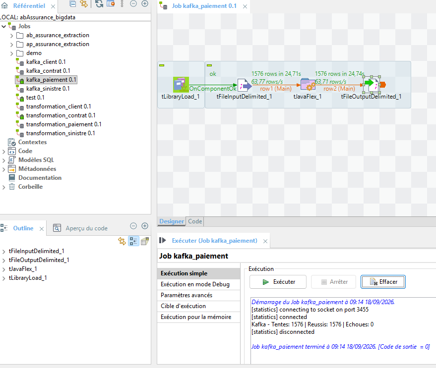

Exemple dans Kafka UI

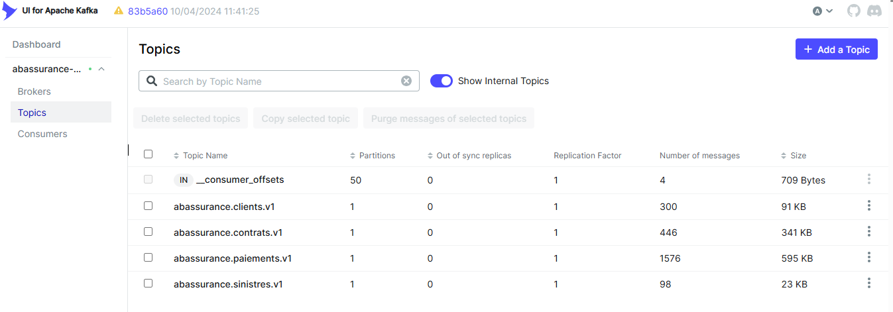

La documentation du nombre de lignes et le temps de transmission est dans le fichier [`transmission_kafka.csv`](../data/logs/transmission_kafka.csv).

## US 3.3 — Synchronisation pendant la phase de transition

Les bases sources Oracle/SQL Server sont simulées via des jeux de données statiques (Faker), il n'existe pas de flux de modifications en direct à synchroniser — l'US3.3 ne peut donc pas être testée dans les conditions réelles décrites par les critères d'acceptation.

Théoriquement, il faudrait mettre en place des connecteurs entre les bases de données Oracle / SQL Server et Kafka Connect, pour capter les modifications au fil de l'eau plutôt qu'en extraction batch.

## US 4.1 Installer l'espace de stockage centralisé

Mise en place du cluster Hadoop HDFS comme espace de stockage centralisé
pour les données AbAssurance/AssurePlus, avant intégration Kafka -> HDFS (US4.2).

1. Ajout d'un 2ᵉ conteneur datanode dans le docker-compose (le cluster n'en comptait qu'un seul), avec dfs.replication=2, pour permettre une réplication réelle des blocs sur plusieurs serveurs.
2. Retrait de l'exposition host des ports HDFS (9870, 9000) : le namenode/datanodes ne sont plus accessibles que depuis le réseau Docker interne
(conteneur "app" uniquement), pour restreindre l'accès aux seules composantes autorisées du pipeline.
3. Validation du cluster : ``docker exec namenode hdfs dfsadmin -report`` (2 datanodes "Live", cluster opérationnel).
4. Création de l'arborescence du data lake : /data/Kafka/{clients,contrats, paiements,sinistres} pour les données brutes issues de Kafka, /data/clean pour les données nettoyées destinées à l'analyse (US5.1).

```shell
docker exec -it namenode hdfs dfs -mkdir -p /data/kafka/clients
docker exec -it namenode hdfs dfs -mkdir -p /data/kafka/contrats
docker exec -it namenode hdfs dfs -mkdir -p /data/kafka/paiements
docker exec -it namenode hdfs dfs -mkdir -p /data/kafka/sinistres
docker exec -it namenode hdfs dfs -mkdir -p /data/clean
```

5. Test d'écriture/lecture Parquet sur cette arborescence via PySpark pour valider le bon fonctionnement du stockage.

```python
df = spark.createDataFrame([("test", 1)], ["nom", "valeur"])
df.write.mode("overwrite").parquet("hdfs://namenode:9000/data/raw/contrats/_test")
spark.read.parquet("hdfs://namenode:9000/data/raw/contrats/_test").show()
```

Critères d'acceptation :

1. Serveur Hadoop installé et fonctionnel -> OK (2 datanodes live, testé)

2. Duplication automatique multi-serveurs -> OK (2 datanodes, replication=2)

3. Espace prévu vs volumes estimés (US1.1) -> OK : dossier des extractions sources actuel = 1,05 Mo (1 106 712 octets), largement couvert par l'espace disque alloué aux volumes Docker (plusieurs Go disponibles)

4. Accès restreint aux personnes autorisées -> Partiellement couvert :

* ports HDFS non exposés au host (accès limité au réseau Docker interne).
* Une authentification forte (Kerberos + Apache Ranger) serait la solution de production, non implémentée ici par simplification.

## US 4.2 — Stocker les données reçues de Kafka dans Hadoop

Mise en place de 4 jobs Spark Structured Streaming (un par topic Kafka :
contrats, paiements, sinistres, clients) consommant en continu les messages
publiés par Talaxie et les écrivant au format Parquet dans HDFS.

* Développement de 4 scripts PySpark Structured Streaming (streaming_contrats.py, streaming_paiements.py, streaming_sinistres.py, streaming_clients.py), un par topic, avec un schéma JSON dédié par type de donnée (contrat, paiement, sinistre, client).
* Ajout du connecteur spark-sql-kafka-0-10 (et ses dépendances kafka-clients, spark-token-provider-kafka-0-10) téléchargés au build de l'image Docker via curl et chargés dans la SparkSession via spark.jars, la version pyspark installée ne l'incluant pas nativement.
* Organisation des dossiers HDFS en deux zones : /data/kafka/topic pour les données brutes reçues de Kafka, /data/clean pour les futures données nettoyées (répond au critère 2 : "dossiers organisés brutes/nettoyées").
* Gestion de checkpoints HDFS dédiés par topic (/data/checkpoints/topic`) pour permettre une reprise sans duplication en cas de redémarrage du job.
* Lancer les scripts `docker exec -it pyspark-app python streaming_topics/streaming_clients.py`

Incident traversé : un problème de permissions sur le volume Docker du broker Kafka (AccessDeniedException, utilisateur non-root du conteneur vs volume créé par root) a provoqué une perte des topics et de leur contenu ; corrigé via chown sur le volume, topics recréés, données republiées depuis Talaxie.

Le nombre de données stockées correspond au nombre de données extraites au départ (aucune perte) : les captures ci-dessous montrent le nombre de lignes de chaque table dans HDFS, et la dernière montre le nombre de messages de chaque topic dans Kafka UI.

Capture d'écran pour client :

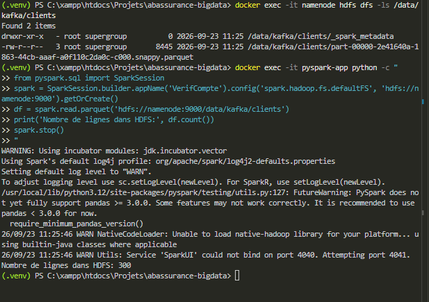

Dans Kafka, il a bien

Capture d'écran pour contrats :

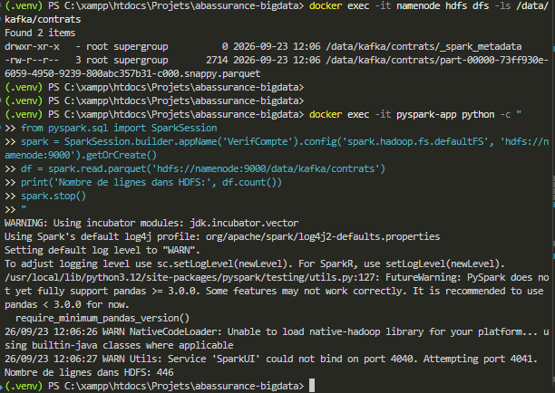

Capture d'écran pour paiements :

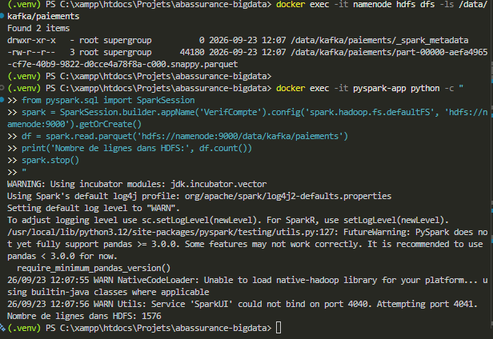

Capture d'écran pour sinistres :

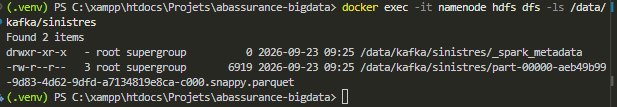
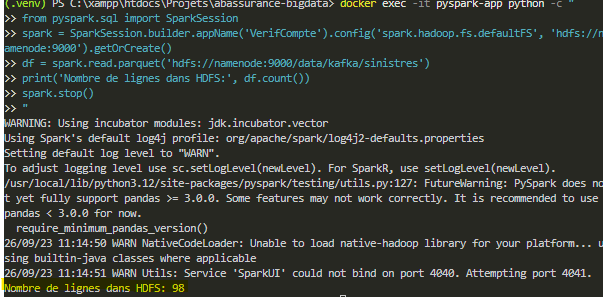

Pour chaque topic, le nombre de lignes correspond bien :

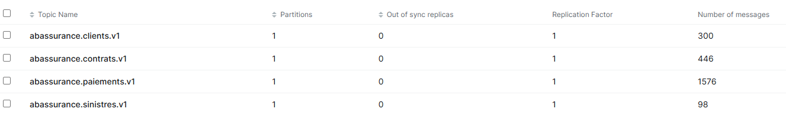

### Résultat dans Hadoop

```shell
(.venv) PS C:\xampp\htdocs\Projets\abassurance-bigdata> docker exec -it namenode hdfs dfs -ls /data/kafka/clients
>> docker exec -it namenode hdfs dfs -ls /data/kafka/contrats
>> docker exec -it namenode hdfs dfs -ls /data/kafka/paiements
>> docker exec -it namenode hdfs dfs -ls /data/kafka/sinistres
Found 2 items
drwxr-xr-x   - root supergroup          0 2026-09-23 11:25 /data/kafka/clients/_spark_metadata
-rw-r--r--   3 root supergroup       8445 2026-09-23 11:25 /data/kafka/clients/part-00000-2e41640a-1863-44cb-aaaf-a0f110c2da0c-c000.snappy.parquet
Found 2 items
drwxr-xr-x   - root supergroup          0 2026-09-23 12:06 /data/kafka/contrats/_spark_metadata
-rw-r--r--   3 root supergroup       2714 2026-09-23 12:06 /data/kafka/contrats/part-00000-73ff930e-6059-4950-9239-800abc357b31-c000.snappy.parquet
Found 2 items
drwxr-xr-x   - root supergroup          0 2026-09-23 12:07 /data/kafka/paiements/_spark_metadata
-rw-r--r--   3 root supergroup      44180 2026-09-23 12:07 /data/kafka/paiements/part-00000-aefa4965-cf7e-40b9-9822-d0cce4a78f8a-c000.snappy.parquet
Found 2 items
drwxr-xr-x   - root supergroup          0 2026-09-23 09:25 /data/kafka/sinistres/_spark_metadata
-rw-r--r--   3 root supergroup       6919 2026-09-23 09:25 /data/kafka/sinistres/part-00000-aeb49b99-9d83-4d62-9dfd-a7134819e8ca-c000.snappy.parquet
```

Exemple du fichier sinistres :

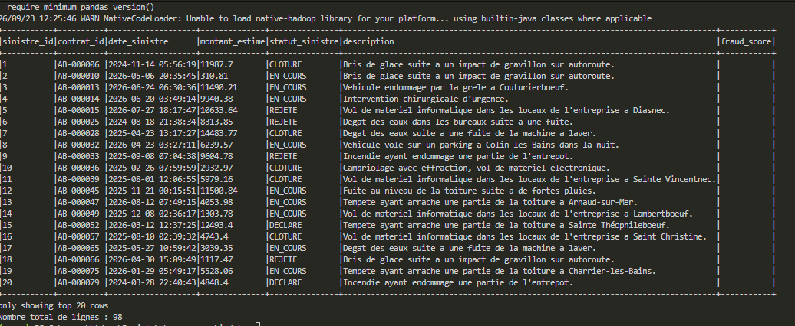

## US 4.3 — Protéger les données sensibles stockées

Ceci est une partie lourde et qui demande du temps. Je vais lister ce qu'il faudrait faire.

> Ce qu'il faudrait implémenter :

*Critère 1* — chiffrer les champs les plus sensibles (num_fiscal, email, téléphone, adresse du topic clients) avant écriture dans HDFS, plutôt que de configurer un chiffrement natif HDFS (Transparent Data Encryption) qui demande une gestion de clés KMS complexe. Ça se fait directement dans le script streaming_clients.py, avec une bibliothèque de chiffrement symétrique simple :

```python
from cryptography.fernet import Fernet
# clé générée une fois et stockée en variable d'environnement
```

*Critère 2* — accès par rôle : un groupe Unix "dev" qui n'a pas accès en lecture au dossier /data/kafka/clients contenant les données sensibles, contre un groupe "analyste" qui y a accès. C'est un vrai mécanisme fonctionnel.

*Critère 3* — audit des connexions : HDFS dispose d'un audit log natif (hdfs-audit.log) censé tracer les opérations de lecture/écriture par utilisateur. Tentative d'activation réalisée : modification de
log4j.properties (NullAppender -> RFAAUDIT), config confirmée rechargée au démarrage du namenode. Cependant, le fichier généré reste vide malgré
des opérations de consultation réelles, sans cause identifiée dans le
temps imparti. En conditions de production, ce mécanisme serait de toute façon complété par une solution plus robuste.
(Apache Ranger avec ses plugins d'audit).

## US 5.1 Analyser les données pour produire des rapports

Pour pouvoir faciliter l'analyse, il faut développer un tableau de bord.
Pour cela j'ai choisi l'outil Streamlit. Il s'intègre bien avec PySpark pour lire du Parquet depuis Hadoop, et plus simple à mettre en place qu'un framework comme Flask ou Django.

### Installation de Streamlit

```shell
python -m pip install streamlit

# Vérifier l'installation
streamlit --version

# Ajouter au requirements.txt
streamlit==1.64.0
```

Création d'une architecture :

abassurance-bigdata/
│
├── .venv/
├── data/
├── Documentations/
├── src/
│   ├── pipeline/
│   └── prediction/
│
├── app/
│   └── app.py
├── Docker/
│   ├── docker-compose.yml/
├   |──Dockerfile/
│   └──requirements.txt
|
└── README.md

Je modifie le Dockerfile afin qu'il lance Streamlit :

```dockerfile
CMD ["streamlit", "run", "app/app.py", "--server.address=0.0.0.0", "--server.port=8501"]
```

J'ajoute le port dans le docker-compose.yml

```yaml
  app:
    build:
      context: ..
      dockerfile: Docker/Dockerfile
    container_name: pyspark-app
    ports:
      - "8501:8501"
    depends_on:
      - namenode
      - datanode
      - datanode2
      - kafka
    environment:
      - SPARK_LOCAL_IP=127.0.0.1
    networks:
      - bigdata
```

### Écriture du tableau de bord (app.py)

Le script se lit en 3 grandes étapes : préparer les outils, calculer les chiffres avec Spark, puis les afficher avec Streamlit.

#### Étape 1 — Connexion à Spark et à Hadoop

```python
import time

import pandas as pd
import streamlit as st
from pyspark.sql import SparkSession
from pyspark.sql import functions as F

DOSSIER_HDFS = "hdfs://namenode:9000/data/kafka"

st.set_page_config(page_title="Tableau de bord AbAssurance", layout="wide")


@st.cache_resource
def demarrer_spark():
    spark = (
        SparkSession.builder.appName("DashboardAbAssurance")
        .master("local[2]")
        .config("spark.driver.memory", "1g")
        .config("spark.hadoop.fs.defaultFS", "hdfs://namenode:9000")
        .getOrCreate()
    )
    return spark


def lire(spark, nom_table):
    """Lire une table (clients, contrats...) dans Hadoop."""
    return spark.read.parquet(DOSSIER_HDFS + "/" + nom_table)
```

Le décorateur `@st.cache_resource` évite de redémarrer Spark à chaque clic
sur la page (démarrer Spark prend plusieurs secondes).

#### Étape 2 — Calcul des indicateurs avec Spark

```python
@st.cache_data(show_spinner="Spark calcule les chiffres à partir de Hadoop...")
def calculer():
    spark = demarrer_spark()
    debut = time.time()

    clients = lire(spark, "clients")
    contrats = lire(spark, "contrats")
    paiements = lire(spark, "paiements")
    sinistres = lire(spark, "sinistres")

    # Nombre de contrats pour chaque statut
    contrats_par_statut = {}
    for ligne in contrats.groupBy("statut_contrat").count().collect():
        statut = ligne["statut_contrat"]
        if statut is None:
            statut = "(vide)"
        contrats_par_statut[statut] = ligne["count"]

    # Montant total estimé des sinistres
    total_sinistres = sinistres.agg(F.sum("montant_estime")).first()[0]
    if total_sinistres is None:
        total_sinistres = 0

    duree = time.time() - debut

    return {
        "nb_clients": clients.count(),
        "nb_contrats": contrats.count(),
        "nb_paiements": paiements.count(),
        "nb_sinistres": sinistres.count(),
        "contrats_par_statut": contrats_par_statut,
        "total_sinistres": total_sinistres,
        "duree": duree,
    }
```

`@st.cache_data` garde le résultat en mémoire : tant qu'on ne demande pas
explicitement un recalcul, on ne relance pas Spark à chaque interaction.

#### Étape 3 — Affichage

```python
st.title("Tableau de bord AbAssurance / AssurePlus")

if st.sidebar.button("Recalculer depuis Hadoop"):
    st.cache_data.clear()

resultats = calculer()

st.subheader("Chiffres clés")
col1, col2, col3, col4 = st.columns(4)
col1.metric("Clients", resultats["nb_clients"])
col2.metric("Contrats", resultats["nb_contrats"])
col3.metric("Paiements", resultats["nb_paiements"])
col4.metric("Sinistres", resultats["nb_sinistres"])

st.info("Temps de traitement Spark : " + str(round(resultats["duree"], 1)) + " secondes")

st.subheader("Contrats")
statuts = list(resultats["contrats_par_statut"].keys())
choix = st.selectbox("Quel statut veux-tu regarder ?", statuts)
st.metric("Nombre de contrats « " + choix + " »", resultats["contrats_par_statut"][choix])

st.subheader("Sinistres")
st.metric("Montant total estimé des sinistres", round(resultats["total_sinistres"], 2))
```

Le menu déroulant (`st.selectbox`) permet de choisir un statut de contrat
(ACTIF, suspendu, résilié) parmi ceux réellement présents dans les données.

#### Amélioration : le graphique change avec le statut choisi

Pour que le menu déroulant ne serve pas qu'à afficher un chiffre isolé, un
second calcul croise le statut avec le type d'assurance, sous la forme d'un
dictionnaire de dictionnaires :

```python
par_statut_et_type = {
    "ACTIF":    {"auto": 300, "habitation": 200},
    "suspendu": {"auto": 20,  "habitation": 10},
}
```

Construction (à l'intérieur de `calculer()`) :

```python
par_statut_et_type = {}
lignes_croisees = contrats.groupBy("statut_contrat", "type_assurance").count().collect()
for ligne in lignes_croisees:
    statut = ligne["statut_contrat"] or "(vide)"
    type_assurance = ligne["type_assurance"] or "(non renseigné)"
    if statut not in par_statut_et_type:
        par_statut_et_type[statut] = {}
    par_statut_et_type[statut][type_assurance] = ligne["count"]
```

Affichage : on ouvre le "tiroir" correspondant au statut choisi, et on
dessine son contenu.

```python
detail_du_statut = resultats["par_statut_et_type"].get(choix, {})
st.bar_chart(pd.Series(detail_du_statut))
```

Le graphique se redessine donc automatiquement à chaque changement de
sélection dans le menu déroulant.

### Ajout des exports (CSV et PDF)

#### Installation de fpdf2

```shell
python -m pip install fpdf2

# Ajouter au requirements.txt
fpdf2==2.8.5
```

#### Export CSV

Chaque table (clients, contrats, paiements, sinistres) est gardée sous
forme de tableau pandas complet, pas juste un échantillon, pour pouvoir
être téléchargée :

```python
def vers_csv(tableau_pandas):
    # encoding="utf-8-sig" : ajoute un marqueur invisible en début de
    # fichier pour qu'Excel affiche correctement les accents.
    return tableau_pandas.to_csv(index=False, sep=";").encode("utf-8-sig")
```

Affichage, un bouton de téléchargement par table :

```python
st.subheader("Exporter les données")
for nom_table, tableau in resultats["tables"].items():
    st.download_button(
        label="Télécharger " + nom_table + ".csv",
        data=vers_csv(tableau),
        file_name=nom_table + ".csv",
        mime="text/csv",
    )
```

Pour les tables clients et sinistres, seules les colonnes non sensibles
sont incluses (pas d'email, téléphone, adresse, numéro fiscal, ni texte
libre de description), cohérent avec la protection des données prévue à
l'US 4.3.

#### Export PDF

Le rapport est construit ligne par ligne avec la librairie `fpdf2` :

```python
from fpdf import FPDF

def generer_rapport_pdf(resultats):
    pdf = FPDF()
    pdf.add_page()

    pdf.set_font("Helvetica", "B", 16)
    pdf.cell(0, 10, "Rapport AbAssurance / AssurePlus", ln=True)

    pdf.set_font("Helvetica", "", 11)
    pdf.cell(0, 8, "Clients : " + str(resultats["nb_clients"]), ln=True)
    pdf.cell(0, 8, "Contrats : " + str(resultats["nb_contrats"]), ln=True)
    pdf.cell(0, 8, "Sinistres : " + str(resultats["nb_sinistres"]), ln=True)

    # pdf.output() renvoie directement les octets du PDF, sans créer
    # de fichier sur le disque : pratique pour le bouton de téléchargement.
    return bytes(pdf.output())
```

Affichage :

```python
st.subheader("Exporter le rapport")
pdf_bytes = generer_rapport_pdf(resultats)
st.download_button(
    label="Télécharger le rapport PDF",
    data=pdf_bytes,
    file_name="rapport_abassurance.pdf",
    mime="application/pdf",
)
```

Un bug a été identifié pendant cette User Story : il est décrit dans l'US 8.1 (identification), puis corrigé dans l'US 8.2.

---

## US 8.1 — Identifier un bug du pipeline

### Symptôme

Dans le tableau de bord, le menu déroulant des statuts de contrat est vide : tous les contrats tombent dans l'étiquette « (vide) ».

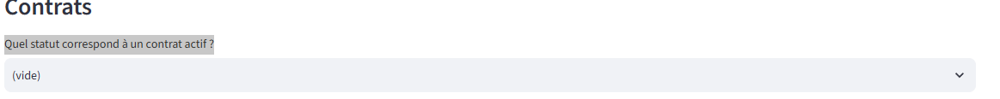


### Étapes de reproduction

1. **Vérifier la source** : dans `data/output/dataClean_fusion/contrats`, les 446 contrats ont un statut renseigné (`ACTIF`, `SUSPENDU`, `RESILIE`, mais aussi `ACTIVE`, `SUSPENDED`, `TERMINATED`).

2. **Compter les statuts dans HDFS** :

```shell
docker exec -it pyspark-app python -c "from pyspark.sql import SparkSession; s=SparkSession.builder.master('local[1]').config('spark.hadoop.fs.defaultFS','hdfs://namenode:9000').getOrCreate(); s.read.parquet('hdfs://namenode:9000/data/kafka/contrats').groupBy('statut_contrat').count().show()"
```

Résultat : les 446 lignes ont `statut_contrat` à `NULL`.

```shell
+--------------+-----+
|statut_contrat|count|
+--------------+-----+
|          NULL|  446|
```

3. **Lire un message brut du topic Kafka** :

```shell
docker exec -it kafka /opt/kafka/bin/kafka-console-consumer.sh --bootstrap-server kafka:19092 --topic abassurance.contrats.v1 --from-beginning --max-messages 2
```

Résultat :

```shell
{"contrat_id":"AB-000001","client_id":"AB-1","type_assurance":"AUTO","code_produit":"","date_debut":"2023-12-16","date_fin":"2024-12-15","prime_annuelle":1808.77,"prime_mensuelle":,"statut_contrat":"ACTIF","agence_id":"20","code_courtier":""}
```

Le champ `"prime_mensuelle":,` n'a pas de valeur : ce n'est pas du JSON valide.

1. **Confirmer l'étendue du problème** : `docker exec -it pyspark-app python -c "from pyspark.sql import SparkSession; s=SparkSession.builder.master('local[1]').config('spark.hadoop.fs.defaultFS','hdfs://namenode:9000').getOrCreate(); d=s.read.parquet('hdfs://namenode:9000/data/kafka/contrats'); print('lignes:', d.count(), '| contrat_id non nul:', d.filter('contrat_id IS NOT NULL').count())"` sur `contrat_id IS NOT NULL` dans le Parquet HDFS : résultat de la commande lignes: 446 | contrat_id non nul: 0.

### Origine

Les contrats AbAssurance n'ont qu'une prime annuelle et les contrats AssurePlus qu'une prime mensuelle. Pour chaque contrat, l'un des deux champs numériques est donc vide :

| Origine | Contrats | Champ vide dans le JSON |
| --- | --- | --- |
| AbAssurance | 299 | `prime_mensuelle` |
| AssurePlus | 147 | `prime_annuelle` |

Le job Talaxie qui publie sur Kafka écrit alors la clé sans valeur, ce qui rend le message invalide. Dans `streaming_contrats.py`, `from_json` ne plante pas sur un message invalide : il renvoie une ligne dont **toutes** les colonnes sont `NULL`. Les 446 messages sont donc devenus 446 lignes vides dans HDFS.

Hypothèse écartée : une clé JSON mal nommée. Dans ce cas, seule la colonne concernée aurait été `NULL`, et le message montre que `statut_contrat` est correctement nommé.

### Impact

* Toute la table `contrats` est inutilisable dans HDFS (statut, type, primes, dates), pas seulement le statut.
* Le nombre de lignes stockées correspond au nombre de lignes extraites (446), ce qui masque le problème dans la vérification de l'US 4.2. Seule la taille du fichier Parquet (2,7 Ko pour 446 lignes) était un indice.
* Les indicateurs du dashboard par statut de contrat (actifs, suspendus, résiliés) sont impossibles à calculer.
* Les topics `clients`, `paiements` et `sinistres` ne sont pas concernés : leurs champs numériques sont tous renseignés dans la fusion (0 valeur vide sur 1576 paiements et 98 sinistres).

### Problème secondaire constaté

Les statuts de contrat sont un mélange de français et d'anglais (6 valeurs au lieu de 3), alors que `mapping_donnees.md` prévoit une harmonisation en français. La traduction `ACTIVE/SUSPENDED/TERMINATED` → `ACTIF/SUSPENDU/RESILIE` n'a pas été faite dans Talaxie à la fusion.

### Critères d'acceptation

* [x] Le bug est reproduit.
* [x] Son origine est identifiée.
* [x] Son impact est documenté.
* [x] Les étapes de reproduction sont décrites.

## US 8.2 — Corriger le bug

### Démarche de recherche d'erreur

Le bug a été localisé en remontant la chaîne, étape par étape, pour éliminer les causes possibles :

| Étape contrôlée | Constat | Conclusion |
| --- | --- | --- |
| Fichier de fusion Talaxie | 446 lignes, statuts renseignés | Source correcte |
| Parquet dans HDFS | 446 lignes, `statut_contrat` à `NULL` | Perte de données après la fusion |
| Script `streaming_contrats.py` | `from_json` associe les champs par nom, le schéma contient bien `statut_contrat` | Script correct |
| Message brut dans Kafka | `"prime_mensuelle":,` (JSON invalide) | **Origine trouvée : le job Talaxie de publication** |

### Correctif

**1. Talaxie : publier un JSON valide**

Faire en sorte que les primes ne soient pas vide dans le JSON. J'ai multiplier par 12 les primes mensuelles et complétet le fichier puis fait de même avec prime annuelle (divisé / 12). j'ai relancer le fichier dans le 
composant : job kafka_contrats.

**2. Talaxie : harmoniser les statuts en français**

Ajouter la traduction dans le composant de transformation des contrats. L'expression ci-dessous est écrite dans le style d'un `tMap` ; elle est à adapter au composant réellement utilisé (la fusion utilise un `tJavaRow`, le `tMap` ayant été abandonné, voir l'US 2.2) :

```java
"ACTIVE".equals(row1.statut_contrat) ? "ACTIF" :
"SUSPENDED".equals(row1.statut_contrat) ? "SUSPENDU" :
"TERMINATED".equals(row1.statut_contrat) ? "RESILIE" :
row1.statut_contrat
```

**3. Repartir d'un état propre**

Les anciens messages invalides restent dans le topic, et le streaming lit depuis le début (`startingOffsets: earliest`). Republier sans nettoyer donnerait 446 lignes vides en plus des 446 bonnes lignes. Il faut donc, dans cet ordre :

```shell
# a. Arrêter streaming_contrats.py (Ctrl+C dans son terminal)

# b. Supprimer le topic contrats (les messages invalides)
docker exec -it kafka /opt/kafka/bin/kafka-topics.sh --bootstrap-server kafka:19092 --delete --topic abassurance.contrats.v1

# c. Le recréer (la création automatique est désactivée dans le docker-compose)
docker exec -it kafka /opt/kafka/bin/kafka-topics.sh --bootstrap-server kafka:19092 --create --topic abassurance.contrats.v1 --partitions 1 --replication-factor 1

# d. Supprimer les données et le checkpoint HDFS des contrats uniquement
docker exec -it namenode hdfs dfs -rm -r -f /data/kafka/contrats /data/checkpoints/contrats
```

Adapter `--partitions` et `--replication-factor` à la configuration d'origine du topic si elle était différente.

**4. Republier et relancer**

* Relancer le job Talaxie de publication des contrats.
* Relancer `python streaming_topics/streaming_contrats.py`.

### Vérification

```shell
docker exec -it pyspark-app python -c "from pyspark.sql import SparkSession; s=SparkSession.builder.master('local[1]').config('spark.hadoop.fs.defaultFS','hdfs://namenode:9000').getOrCreate(); d=s.read.parquet('hdfs://namenode:9000/data/kafka/contrats'); print('lignes:', d.count()); d.groupBy('statut_contrat').count().show()"
```

Résultat attendu : 446 lignes et 3 statuts (`ACTIF`, `SUSPENDU`, `RESILIE`).

Résultat obtenu :

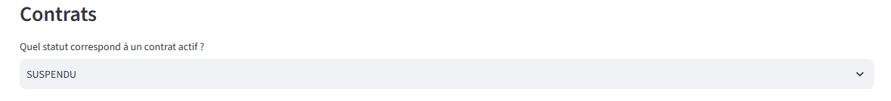

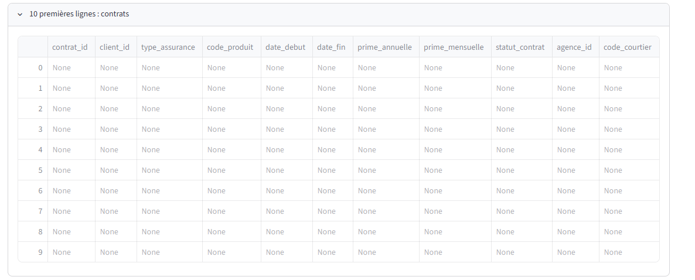

### Non-régression

* Le nombre de ligness des topics `clients`, `paiements` et `sinistres` dans HDFS est inchangé.
* Le tableau de bord affiche le menu des statuts (Actif / Suspendu / Résilié) avec les bons comptages.
* Le dictionnaire de correspondance des statuts ajouté dans `app.py` reste en place comme garde-fou, il n'a plus d'effet une fois les données corrigées à la source.

### Critères d'acceptation

* [ ] Le correctif est développé.
* [ ] Les fonctionnalités existantes continuent de fonctionner.
* [ ] Le correctif est documenté.

---

## US 5.2 : Préparer les données pour la future IA

### Objectif

L'objectif de cette User Story est de préparer les données nécessaires à l'entraînement du futur modèle de détection de fraude.

Construire **une ligne par sinistre**, avec des caractéristiques (features) susceptibles de révéler une fraude, et une cible (`est_suspect`) quand le score de fraude est connu. Le résultat est écrit dans HDFS, prêt à être relu par l'US 5.3 (entraînement du modèle).

---

### Fichiers utilisés

Le traitement repose principalement sur deux fichiers :

* `src/pipeline/preparer_dataset_fraude.py` : il s'agit du script principal permettant de préparer le jeu de données.
* `nettoyage_donnees_ia.py` : ce fichier contient notamment les fonctions `nettoyer` et `harmoniser_statuts`.

Les données utilisées en entrée sont stockées dans HDFS aux emplacements suivants :

`hdfs://namenode:9000/data/kafka/{clients,contrats,paiements,sinistres}`

Ces fichiers au format Parquet sont produits à partir des données récupérées par Spark Streaming.

Le traitement produit ensuite deux jeux de données :

* `hdfs://namenode:9000/data/clean/dataset_fraude_entrainement`
* `hdfs://namenode:9000/data/clean/dataset_fraude_a_predire`

Le dictionnaire de données du dataset est disponible dans [`dictionnaire_dataset.md`](./dictionnaire_dataset.md).

---

#### Fonctionnement du traitement

La préparation des données se déroule en plusieurs étapes.

##### Lecture et nettoyage des données

Le script commence par lire les quatre tables présentes dans HDFS : clients, contrats, paiements et sinistres.

Les données sont ensuite nettoyées grâce aux fonctions déjà développées dans l'US 5.1. Cette étape permet notamment :

* de supprimer les espaces inutiles ;
* de transformer les chaînes de caractères vides en valeurs `null` ;
* d'harmoniser les différents statuts utilisés dans les données ;
* de supprimer les doublons.

La déduplication doit être réalisée avec des identifiants adaptés afin de ne pas supprimer des données provenant de sources différentes.

##### Création d'un résumé des paiements

Les paiements sont regroupés par contrat afin de créer deux nouvelles informations :

* `nb_paiements` : nombre total de paiements associés au contrat ;
* `nb_paiements_echoues` : nombre de paiements dont le statut est `ECHOUE`.

Ces informations permettront ensuite au modèle d'avoir une vision plus complète de l'historique du contrat.

##### Regroupement des différentes données

Les tables sont ensuite regroupées grâce à des `left join` réalisés sur le champ `contrat_id`.

Pour chaque sinistre, le traitement récupère ainsi les informations concernant :

* le contrat associé ;
* les paiements effectués pour ce contrat ;
* les informations nécessaires à l'analyse du sinistre.

Le choix du `left join` permet de conserver tous les sinistres, même lorsqu'aucune information correspondante n'est disponible dans les autres tables.

##### Création de la variable `jours_avant_sinistre`

Une nouvelle variable appelée `jours_avant_sinistre` est calculée.

Elle correspond au nombre de jours entre la date de début du contrat (`date_debut`) et la date à laquelle le sinistre a été déclaré (`date_sinistre`).

Cette information peut être intéressante pour la détection de fraude. Par exemple, un sinistre déclaré très peu de temps après la souscription d'un contrat peut constituer un élément à prendre en compte par le modèle.

Lorsque certaines informations sont absentes, les valeurs de `nb_paiements`, `nb_paiements_echoues` et `montant_estime` sont remplacées par `0`.

##### Vérification de la cohérence des données

Certaines lignes sont supprimées lorsqu'elles ne correspondent pas aux critères attendus.

Le traitement conserve uniquement les sinistres pour lesquels :

* `montant_estime > 0` ;
* `jours_avant_sinistre >= 0`.

Cela permet d'éviter de transmettre au futur modèle des données incohérentes.

##### Sélection des informations utiles

Après les différentes étapes de préparation, seules les colonnes nécessaires au futur modèle sont conservées :

* `sinistre_id`
* `contrat_id`
* `montant_estime`
* `statut_sinistre`
* `type_assurance`
* `prime_annuelle`
* `jours_avant_sinistre`
* `nb_paiements`
* `nb_paiements_echoues`
* `fraud_score`

L'objectif est de conserver uniquement les informations utiles à l'analyse des sinistres.

##### Création des deux jeux de données

Le dataset final est séparé en deux parties.

**Le jeu d'entraînement** contient les sinistres pour lesquels le `fraud_score` est connu.

Une nouvelle variable appelée `est_suspect` est créée à partir de ce score :

* si `fraud_score >= 70`, alors `est_suspect = 1` ;
* sinon, `est_suspect = 0`.

Cette variable constitue la **cible que le modèle devra apprendre à prédire**.

**Le jeu de données à prédire** contient les sinistres pour lesquels le `fraud_score` n'est pas disponible.

Ces données seront utilisées ultérieurement par le modèle afin d'obtenir une prédiction.

---

### Exécution du traitement

Le script de préparation n'est pas un traitement en continu comme le streaming Kafka/Spark.

Il s'agit d'un traitement ponctuel : il est lancé, prépare les données présentes dans HDFS, produit les deux datasets puis s'arrête.

Pour exécuter le script, les commandes suivantes sont utilisées :

```powershell
# Copier le script dans docker
docker cp src/pipeline/preparer_dataset_fraude.py pyspark-app:/app/src/pipeline/preparer_dataset_fraude.py
# Execution du script
docker exec -it pyspark-app python /app/src/pipeline/preparer_dataset_fraude.py
```

---

### Résultats obtenus

Après l'exécution du traitement, les résultats suivants sont obtenus :

| Élément                           | Résultat |
| --------------------------------- | -------: |
| Sinistres présents dans HDFS      |       98 |
| Sinistres provenant d'AbAssurance |       61 |
| Sinistres provenant d'AssurePlus  |       37 |
| Lignes d'entraînement             |       37 |
| Sinistres suspects                |        7 |
| Sinistres non suspects            |       30 |
| Lignes à prédire                  |       61 |

Les **37 sinistres provenant d'AssurePlus** disposent d'un `fraud_score`, grâce au champ `AP_FRAUD_SCORE`. Ils peuvent donc être utilisés pour construire le jeu d'entraînement.

Les **61 sinistres provenant d'AbAssurance** ne possèdent pas ce score. Ils constituent donc le jeu de données qui sera utilisé pour effectuer les futures prédictions.

---

### Problèmes rencontrés et solutions apportées

#### Problème de doublons entre les deux sources

Un problème est apparu lors de la déduplication.

Au départ, 98 sinistres étaient présents dans Kafka et HDFS, mais seulement 61 étaient conservés par le script. De plus, aucune ligne d'entraînement n'était obtenue.

La cause était liée aux identifiants utilisés par les deux sources.

AbAssurance et AssurePlus utilisent chacune des identifiants de sinistre commençant à `1`. Ainsi, deux sinistres différents pouvaient avoir le même `sinistre_id`.

Par exemple :

```text
AB-000006 → sinistre_id = 1
AP-000003 → sinistre_id = 1
```

Ces deux lignes correspondent pourtant à deux sinistres différents.

La commande suivante avait donc un problème :

```python
sinistres.dropDuplicates(["sinistre_id"])
```

Elle considérait les deux sinistres comme des doublons et en supprimait un. Dans ce cas, le sinistre provenant d'AssurePlus pouvait être supprimé alors qu'il contenait le `fraud_score` nécessaire à l'entraînement.

Pour résoudre ce problème, une clé de déduplication plus précise a été utilisée :

```python
clients = clients.dropDuplicates(["client_id", "email"])

contrats = contrats.dropDuplicates(["contrat_id", "client_id"])

paiements = paiements.dropDuplicates(["paiement_id", "contrat_id"])

sinistres = sinistres.dropDuplicates(["sinistre_id", "contrat_id"])
```

Le `contrat_id` permet notamment de distinguer les données provenant des différentes sources puisque les contrats possèdent des préfixes différents (`AB-` et `AP-`).

Grâce à cette modification, les **98 sinistres sont désormais conservés**, dont les **37 sinistres possédant un `fraud_score`**.

---

### Vérifications effectuées

Plusieurs vérifications peuvent être réalisées afin de s'assurer que les données ont correctement été produites.

#### Vérification des offsets Kafka

```powershell
docker exec kafka /opt/kafka/bin/kafka-get-offsets.sh --bootstrap-server localhost:9092 --topic abassurance.sinistres.v1
```

#### Vérification des fichiers produits dans HDFS

```powershell
docker exec namenode hdfs dfs -ls /data/clean/dataset_fraude_entrainement

Found 2 items
-rw-r--r--   3 root supergroup          0 2026-10-02 06:41 /data/clean/dataset_fraude_entrainement/_SUCCESS
-rw-r--r--   3 root supergroup       4306 2026-10-02 06:41 /data/clean/dataset_fraude_entrainement/part-00000-83b34fad-63dc-435f-90e8-d2b29c565724-c000.snappy.parquet


docker exec namenode hdfs dfs -ls /data/clean/dataset_fraude_a_predire

Found 2 items
-rw-r--r--   3 root supergroup          0 2026-10-02 06:41 /data/clean/dataset_fraude_a_predire/_SUCCESS
-rw-r--r--   3 root supergroup       4607 2026-10-02 06:41 /data/clean/dataset_fraude_a_predire/part-00000-3ffcb227-b9da-480d-b6f8-b8d20506b051-c000.snappy.parquet
```

Ces commandes permettent notamment de vérifier que les datasets ont bien été créés dans HDFS.

---

### Limites du jeu de données

Plusieurs limites doivent être prises en compte avant d'utiliser ces données pour entraîner le modèle.

#### Quantité limitée de données

Le jeu d'entraînement contient seulement **37 lignes**, dont **7 sinistres considérés comme suspects**.

Cette quantité de données est faible pour entraîner un modèle d'intelligence artificielle de manière fiable.

#### Seuil utilisé pour définir un sinistre suspect

Le seuil de `70` utilisé pour créer la variable `est_suspect` est actuellement défini de manière arbitraire.

Il devra être vérifié en fonction de la distribution réelle des `fraud_score` et éventuellement adapté.

#### Différence entre les deux sources

Le modèle sera entraîné à partir des données d'AssurePlus, puis utilisé sur les données d'AbAssurance.

Il existe donc un risque que les caractéristiques des deux sources soient différentes, par exemple concernant les montants des sinistres ou les délais entre la souscription et la déclaration.

Cette différence devra être prise en compte lors de l'évaluation du modèle.

#### Utilisation du `fraud_score`

Enfin, le `fraud_score` ne doit pas être utilisé comme variable d'entrée du modèle.

Il sert uniquement à créer la variable cible `est_suspect`.

Le modèle devra apprendre à identifier les sinistres suspects à partir des autres informations disponibles, puis utiliser ces informations pour effectuer ses propres prédictions.

#### Contrats AssurePlus : `prime_annuelle` et `type_assurance` vides (problème identifié)

Les contrats AssurePlus ne fournissent qu'une prime **mensuelle** (`prime_mensuelle`) et un **code produit** (`code_produit`, par exemple `AUTO_BASIC`). Dans les données fusionnées, les 147 contrats AssurePlus ont donc `prime_annuelle` et `type_assurance` vides. Le script de préparation ne convertit pas ces informations : il récupère `prime_annuelle` et `type_assurance` telles quelles depuis la table des contrats.

Conséquence : les 37 sinistres du jeu d'entraînement, tous issus d'AssurePlus, ont ces deux colonnes vides. Lors de l'entraînement (US 5.3), les valeurs vides sont remplacées par `0` : la caractéristique `prime_annuelle` est donc constante sur tout l'entraînement, et le modèle ne peut rien en apprendre. L'arbre appris le confirme : il n'utilise jamais la caractéristique `prime_annuelle`.

Correctif prévu : calculer `prime_annuelle` à partir de `prime_mensuelle` (× 12) et déduire `type_assurance` du code produit (comme le fait déjà la fonction `preparer_contrats` de `nettoyage_donnees_ia.py`, qui n'est pas appelée par le pipeline), puis relancer la préparation et l'entraînement et mettre à jour les chiffres de l'US 5.3

## US 5.3 : Entraîner un modèle de détection de fraude et l'afficher dans le dashboard

### Objectif

L'objectif de cette User Story est de construire le modèle d'intelligence artificielle de détection de fraude, à partir des données préparées dans l'US 5.2.

Le modèle apprend sur les sinistres dont le niveau de fraude est connu (AssurePlus), puis estime une **probabilité de fraude** pour les sinistres qui n'ont pas de score (AbAssurance). Les résultats sont enregistrés dans HDFS et affichés dans une page dédiée du dashboard Streamlit.

---

### Fichiers utilisés

* `src/prediction/entrainer_modele_fraude.py` : script qui entraîne, évalue et sauvegarde le modèle, puis calcule les prédictions.
* `app/pages/Detection_de_fraude.py` : page du dashboard Streamlit qui affiche les résultats et propose un simulateur.

Les données en entrée sont celles produites par l'US 5.2 :

* `hdfs://namenode:9000/data/clean/dataset_fraude_entrainement` (37 sinistres avec la cible `est_suspect`)
* `hdfs://namenode:9000/data/clean/dataset_fraude_a_predire` (61 sinistres sans score)

Le traitement produit trois éléments dans HDFS :

* `hdfs://namenode:9000/data/models/modele_fraude` : le modèle entraîné, sauvegardé pour être rechargé sans le réentraîner ;
* `hdfs://namenode:9000/data/clean/predictions_fraude` : la probabilité de fraude de chaque sinistre à prédire ;
* `hdfs://namenode:9000/data/clean/metriques_fraude` : les indicateurs de qualité du modèle (une seule ligne).

---

#### Choix du modèle : un arbre de décision

Le modèle utilisé est un **arbre de décision** (`DecisionTreeClassifier` de Spark ML).

Un arbre de décision fonctionne comme un questionnaire : « le montant dépasse-t-il tel seuil ? », puis « le sinistre est-il déclaré moins de X jours après la souscription ? », etc. Chaque réponse oriente vers une branche, et chaque extrémité (« feuille ») donne un verdict.

Ce choix a été fait pour trois raisons :

* **il est explicable** : on peut afficher les règles apprises et les expliquer à un gestionnaire de sinistres ou à un jury, ce qui est impossible avec un réseau de neurones ;
* **il est adapté aux petits jeux de données** : avec 37 lignes, un modèle plus complexe apprendrait « par cœur » les exemples au lieu de généraliser ;
* **il est natif de Spark ML** : il s'intègre à la stack Big Data du projet sans dépendance supplémentaire.

---

#### Fonctionnement du traitement

#### Choix des caractéristiques (features)

Le modèle utilise cinq caractéristiques numériques :

| Caractéristique | Signification |
| --- | --- |
| `montant_estime` | montant estimé du sinistre (€) |
| `prime_annuelle` | prime annuelle du contrat (€) |
| `jours_avant_sinistre` | jours entre le début du contrat et le sinistre |
| `nb_paiements` | nombre de paiements du contrat |
| `nb_paiements_echoues` | dont paiements échoués |

Le `fraud_score` n'est **jamais** utilisé comme entrée : il sert uniquement à fabriquer la cible `est_suspect` (voir US 5.2). L'utiliser reviendrait à donner la réponse au modèle avant l'examen.

Seules des colonnes **numériques**, présentes dans les deux sources (AbAssurance et AssurePlus), ont été retenues. Les colonnes textuelles comme `type_assurance` et `statut_sinistre` ne sont donc pas utilisées.

Avant l'entraînement, une étape de préparation (`preparer`) force ces cinq colonnes au type nombre décimal (`double`) et remplace les valeurs vides par `0`, car Spark ML n'accepte pas de valeurs manquantes dans le vecteur d'entrée.

#### Construction du pipeline

Le traitement est un `Pipeline` Spark ML en deux étapes :

1. **`VectorAssembler`** : rassemble les cinq colonnes en une seule colonne `features`, car Spark ML attend un vecteur en entrée. L'ordre des colonnes est important : c'est pourquoi la même liste est utilisée dans le script d'entraînement et dans la page du dashboard.
2. **`DecisionTreeClassifier`** : l'arbre lui-même, avec deux réglages importants :
   * `maxDepth=3` : l'arbre ne peut poser que 3 questions successives. Une profondeur limitée évite le surapprentissage, c'est-à-dire un arbre qui retient les 37 exemples par cœur au lieu de comprendre ce qui distingue une fraude.
   * `weightCol="poids"` : chaque sinistre a un poids. Comme il y a seulement 7 suspects contre 30 non suspects, les cas suspects reçoivent un poids plus fort. Sans cela, le modèle pourrait répondre « non suspect » à chaque fois et avoir raison dans 81 % des cas, tout en étant inutile.

Le poids d'un sinistre suspect est égal au nombre de non-suspects divisé par le nombre de suspects (30 / 7 ≈ 4,3), et celui d'un non-suspect vaut 1. Un suspect « compte » donc environ quatre fois plus qu'un non-suspect, ce qui rééquilibre les deux groupes.

Un garde-fou arrête le script si le jeu d'entraînement ne contient pas à la fois des suspects et des non-suspects, car l'arbre ne pourrait rien apprendre.

#### Évaluation du modèle

Avec seulement 37 lignes, il n'est pas possible de mettre de côté un jeu de test classique sans que celui-ci devienne trop petit pour être significatif.

L'évaluation utilise donc une **validation croisée à 5 plis** (fonction `evaluer`).

Concrètement :

1. les 37 sinistres sont répartis en 5 paquets (les « plis ») d'environ 7 ou 8 lignes ;
   On coupe les 37 lignes en 5 paquets (les 5 plis), d'environ 7 ou 8 lignes chacun.
    Tour 1 : on entraîne sur les plis 2, 3, 4 et 5, et on teste sur le pli 1.
    Tour 2 : on entraîne sur les plis 1, 3, 4 et 5, et on teste sur le pli 2.
2. pour chaque pli, le modèle est entraîné sur les 4 autres plis, puis testé sur le pli mis de côté ;
3. à la fin, chaque sinistre a été prédit par un modèle qui ne l'avait jamais vu, et toutes ces prédictions sont rassemblées pour calculer :

* la **précision (suspects)** : parmi les sinistres que le modèle signale comme suspects, quelle part l'est réellement ? C'est la mesure des « fausses alertes » ;
* le **rappel (suspects)** : parmi les vrais sinistres suspects, quelle part le modèle a-t-il trouvée ? C'est la mesure des fraudes « qui passent entre les mailles ».

Les suspects étant très rares (7 sur 37), un tirage au hasard pourrait mettre tous les suspects dans le même pli, et certains plis de test n'en contiendraient aucun. Les suspects et les non-suspects sont donc numérotés **séparément**, puis répartis à égalité entre les 5 plis (numéro de la ligne modulo 5). Chaque pli contient ainsi 1 ou 2 suspects. Le tirage utilise une graine fixe (`rand(42)`), ce qui rend l'évaluation reproductible, et `cache()` fige la numérotation pour qu'elle ne change pas entre deux utilisations.

Ces deux indicateurs sont enregistrés dans `metriques_fraude`, avec le nombre de lignes et le nombre de suspects.

#### Entraînement final et prédictions

Une fois l'évaluation faite, le modèle est entraîné une dernière fois sur les 37 sinistres, puis :

* il est sauvegardé dans `/data/models/modele_fraude` ;
* il est appliqué aux 61 sinistres d'AbAssurance ;
* la probabilité de la classe « suspect » est extraite dans une colonne `proba_fraude`, et le verdict de l'arbre (0 ou 1) dans une colonne `suspect` ;
* le résultat est enregistré dans `predictions_fraude` avec `sinistre_id`, `contrat_id` et les cinq caractéristiques, ce qui permet de retrouver chaque sinistre.

### Lecture des résultats

Les données sont générées aléatoirement : il n'existe pas de lien réel entre les caractéristiques et la fraude. Le modèle ne peut donc pas apprendre de motif utile, et ses scores (précision 8 %, rappel 14 %) ne sont pas exploitables. Sur 37 sinistres dont 7 suspects, le hasard donnerait déjà une précision d'environ 19 % (7 sur 37) : le modèle fait moins bien que le hasard. Un rappel de 14 % correspond à un seul suspect retrouvé sur les 7. Ce modèle démontre la chaîne technique (préparation, entraînement avec validation croisée, sauvegarde, utilisation dans l'application), pas une capacité de détection. Sur des données réelles, le jeu d'entraînement serait bien plus grand et les étiquettes issues d'enquêtes.

---

#### Page du dashboard « Détection de fraude »

La page lit les résultats dans HDFS et se compose de quatre parties :

1. **Qualité du modèle** : nombre de sinistres d'entraînement, nombre de suspects, précision et rappel, accompagnés d'un avertissement rappelant que les chiffres sont indicatifs.
2. **Sinistres à surveiller** : un curseur règle le seuil de probabilité ; le tableau affiche les sinistres au-dessus du seuil, triés du plus suspect au moins suspect, avec la probabilité affichée en pourcentage. Un export CSV (séparateur `;`, ouvrable directement dans Excel) contient la colonne `proba_fraude (%)` : la probabilité y est écrite en pourcentage entier (0,84 devient 84), grâce à la fonction `probas_en_pourcentage` de `outils.py`, partagée avec la version en ligne.
3. **Ce que le modèle a appris** : un graphique de l'importance de chaque caractéristique et les règles de l'arbre en texte.
4. **Simulateur** : l'utilisateur saisit les cinq caractéristiques d'un sinistre fictif et obtient sa probabilité de fraude, calculée par le modèle sauvegardé.

Deux choix techniques permettent à la page de rester fluide :

* `@st.cache_resource` garde la session Spark et le modèle en mémoire, au lieu de les recréer à chaque clic ;
* `@st.cache_data` mémorise la lecture des résultats dans HDFS. Un bouton « Recharger depuis Hadoop » dans la barre latérale vide ces mémoires lorsque le modèle a été réentraîné.

Si les fichiers sont absents de HDFS, la page affiche un message d'erreur explicite et indique les scripts à lancer.

La conversion des résultats Spark vers un tableau pandas est faite avec `.collect()` plutôt que `.toPandas()`, pour éviter les problèmes de compatibilité entre PySpark et pandas 3 (voir l'avertissement affiché au lancement de Spark).

---

### Exécution du traitement

Comme pour l'US 5.2, il s'agit d'un traitement ponctuel : il est lancé, produit les résultats, puis s'arrête.

```powershell
# 1. Copier le script dans docker
docker cp src/prediction/entrainer_modele_fraude.py pyspark-app:/app/src/prediction/entrainer_modele_fraude.py
Successfully copied 9.22kB to pyspark-app:/app/src/prediction/entrainer_modele_fraude.py

# 2. Exécuter l'entraînement
# 2. Exécuter l'entraînement
docker exec -it pyspark-app python /app/src/prediction/entrainer_modele_fraude.py

Entraînement :  37 lignes dont 7 suspects
Précision (suspects) : 0.08
Rappel (suspects)    : 0.14
Règles apprises (feature 0 = montant_estime, 1 = prime_annuelle, etc.) :
DecisionTreeClassificationModel: uid=DecisionTreeClassifier_084c9c325c18, depth=3, numNodes=11, numClasses=2, numFeatures=5
  If (feature 1 <= 1012.5)
   If (feature 0 <= 809.0900268554688)
    Predict: 0.0
   Else (feature 0 > 809.0900268554688)
    If (feature 4 <= 2.5)
     Predict: 1.0
    Else (feature 4 > 2.5)
     Predict: 0.0
  Else (feature 1 > 1012.5)
   If (feature 0 <= 3456.405029296875)
    If (feature 1 <= 2111.3999999999996)
     Predict: 0.0
    Else (feature 1 > 2111.3999999999996)
     Predict: 1.0
   Else (feature 0 > 3456.405029296875)
    Predict: 0.0

Modèle sauvegardé : hdfs://namenode:9000/data/models/modele_fraude
Prédictions enregistrées : 61

Le raisonnement :
Question 1 : la prime annuelle est-elle de 1 012,50 € ou moins ?
 ├─ OUI → Question 2 : le montant estimé dépasse-t-il 809,09 € ?
 │         ├─ NON → pas suspect
 │         └─ OUI → Question 3 : le contrat a-t-il 2 paiements échoués ou moins ?
 │                   ├─ OUI → SUSPECT
 │                   └─ NON (3 ou plus) → pas suspect
 └─ NON (prime supérieure à 1 012,50 €) → Question 2 : le montant estimé est-il de 3 456,41 € ou moins ?
           ├─ OUI → Question 3 : la prime dépasse-t-elle 2 111,40 € ?
           │         ├─ OUI → SUSPECT
           │         └─ NON → pas suspect
           └─ NON (montant supérieur à 3 456,41 €) → pas suspect

# 3. Vérifier les fichiers produits dans HDFS
docker exec namenode hdfs dfs -ls /data/clean/
Found 4 items
drwxr-xr-x   - root supergroup          0 2026-10-02 15:21 /data/clean/dataset_fraude_a_predire
drwxr-xr-x   - root supergroup          0 2026-10-02 15:21 /data/clean/dataset_fraude_entrainement
drwxr-xr-x   - root supergroup          0 2026-10-02 15:25 /data/clean/metriques_fraude
drwxr-xr-x   - root supergroup          0 2026-10-02 15:25 /data/clean/predictions_fraude

docker exec namenode hdfs dfs -ls /data/models/
Found 1 items
drwxr-xr-x   - root supergroup          0 2026-10-02 15:25 /data/models/modele_fraude
```

Après l'exécution, `predictions_fraude` et `metriques_fraude` doivent apparaître dans `/data/clean/`, et `modele_fraude` dans `/data/models/`. Il suffit ensuite de cliquer sur « Recharger depuis Hadoop » dans le dashboard.

---

### Résultats obtenus

| Élément | Résultat |
| --- | -------: |
| Sinistres d'entraînement | 37 |
| dont suspects | 7 |
| Précision (suspects) | 8 % |
| Rappel (suspects) | 14 % |
| Sinistres prédits (AbAssurance) | 61 |
| Sinistres au-dessus du seuil de 0,5 | 25 |

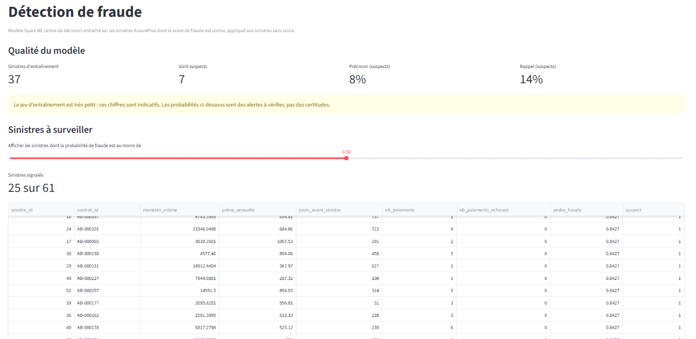

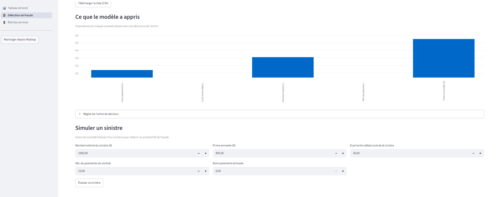

---

### Problèmes rencontrés et solutions apportées

#### Erreur de nom de paramètre dans le classifieur

Lors du premier lancement, le script d'entraînement s'est arrêté avec l'erreur suivante :

```text
TypeError: DecisionTreeClassifier.__init__() got an unexpected keyword argument 'featureCol'
```

Le paramètre de Spark ML s'appelle `featuresCol` (avec un **s**), alors que `labelCol` et `weightCol` s'écrivent au singulier. Une lettre en trop ou en moins suffit à faire échouer l'appel.

```python
# Avant (erreur)
DecisionTreeClassifier(featureCol="features", ...)

# Après
DecisionTreeClassifier(featuresCol="features", ...)
```

#### Page du dashboard en erreur « PATH_NOT_FOUND »

Pendant que le script d'entraînement était en échec, la page du dashboard affichait :

```text
AnalysisException: [PATH_NOT_FOUND] Path does not exist: hdfs://namenode:9000/data/clean/predictions_fraude
```

Ce n'était pas un bug de la page : elle cherchait des résultats que le script n'avait jamais pu écrire. Un `hdfs dfs -ls /data/clean/` a permis de le confirmer, puisque seuls les deux datasets de l'US 5.2 étaient présents. Après correction du script et relance de l'entraînement, la page fonctionne.

---

### Limites du modèle

Cette US met en place la chaîne complète (données, modèle, dashboard), mais les résultats ne doivent pas être pris pour des certitudes.
Le modèle apprend sur **37 sinistres, dont 7 suspects**. Avec si peu de cas positifs, un seul suspect mal classé fait varier le rappel d'environ 14 points (1 sur 7), et chaque pli de test ne contient que 1 ou 2 suspects. Les indicateurs affichés sont donc très instables et ne servent qu'à donner un ordre de grandeur.
Le modèle apprend sur AssurePlus mais prédit sur AbAssurance. Si les deux assureurs ont des habitudes différentes (montants moyens, délais de déclaration, primes), les règles apprises peuvent ne pas se transposer correctement. C'est la limite la plus importante du projet.

Les 61 sinistres d'AbAssurance n'ont pas de `fraud_score`. Il est donc impossible de savoir si les prédictions sont justes : les métriques affichées mesurent uniquement la qualité sur AssurePlus.
La cible `est_suspect` repose sur le seuil `fraud_score >= 70`, défini sans analyse de la distribution des scores (limite déjà identifiée dans l'US 5.2). Changer ce seuil changerait les données d'entraînement et donc le modèle.

Avec un arbre de profondeur 3, le modèle ne peut produire qu'un petit nombre de valeurs de probabilité différentes (une par feuille). Le curseur de seuil du dashboard produit donc des paliers, plutôt qu'un classement fin des sinistres.

Pour ces raisons, les résultats affichés doivent être lus comme des **alertes à faire vérifier par un humain**, et non comme des décisions automatiques.

---

### Pistes d'amélioration

* collecter davantage de sinistres étiquetés, ou obtenir des scores de fraude côté AbAssurance ;
* comparer l'arbre à d'autres modèles (forêt aléatoire, régression logistique) lorsque le volume de données le permettra ;
* ajuster le seuil de 70 après analyse de la distribution des `fraud_score` ;
* comparer les distributions des variables entre AssurePlus et AbAssurance pour mesurer l'écart entre les deux sources.

## US 6.1 : Ne jamais couper les applications existantes

Limite assumée : Le projet étant une simulation sans système en production, ces mesures sont décrites mais n'ont pas pu être testées en conditions réelles.

Imaginons :

Les anciennes bases (Oracle, SQL Server) ne sont jamais modifiées ni arrêtées. Le pipeline ne fait que les lire. L'ancien et le nouveau système tournent en parallèle pendant la transition.

* Plan de secours : comme l'ancien système reste intact, le retour en arrière consiste à continuer de l'utiliser et à couper le pipeline.
On peut aussi relancer l'extraction depuis la source, car les checkpoints Spark et les topics Kafka permettent de rejouer les données.

* Tests après chaque étape : après chaque étape (extraction, Kafka, Hadoop), on vérifie que les applications existantes répondent encore, avec des contrôles de comptage.

## US 6.2 : Vérifier la disponibilité des services

### 1. Objectif

Permettre au Responsable Métier de surveiller **en un coup d'œil** chaque étape du parcours des données, afin de détecter rapidement un problème.

Parcours des données : **Talaxie → Kafka → Hadoop → Spark**

Une page « État des services » a été ajoutée au tableau de bord Streamlit (fichier `app/pages/Etat_des_services.py`).

### 2. Ce qui est surveillé

| Étape | Comment on la vérifie | Voyant vert si… |
| --- | --- | --- |
| Talaxie | Non surveillé | (gris) Talaxie tourne sur le PC, hors Docker : le tableau de bord ne peut pas le voir |
| Kafka | Test de connexion sur `kafka:19092` (porte interne Docker) | Kafka répond |
| Hadoop (HDFS) | Question posée au namenode : combien de datanodes sont en bonne santé ? | Les 2 datanodes sont vivants |
| Streaming (Kafka → Hadoop) | Lecture du contenu des dossiers `/data/kafka/clients`, `contrats`, `paiements`, `sinistres` | Les 4 tables contiennent des fichiers |
| Spark | Petit calcul de test (compter de 0 à 9) | Spark renvoie le bon résultat |

### 3. Le cas particulier de Hadoop

La réplication est réglée sur **2** (`dfs_replication=2`) et il y a **2 datanodes** : chaque donnée est stockée en double.

| Datanodes en bonne santé | Voyant | Signification |
| --- | --- | --- |
| 2 sur 2 | Vert | Tout va bien, chaque donnée existe en double |
| 1 sur 2 | Rouge (« dégradé ») | Les données restent lisibles grâce à l'autre datanode, mais il n'y a plus de copie de secours |
| 0 | Rouge | Les données sont peut-être inaccessibles |

**Détail important :** quand un datanode s'arrête, Hadoop attend environ 10 minutes avant de le déclarer « mort », pour éviter de réagir à une coupure brève. Pour être alerté plus tôt, la page surveille aussi l'état **« stale » (silencieux)**, atteint après environ 30 secondes sans signal.

### 4. Les alertes

* **Alerte visuelle** : une bannière rouge s'affiche en haut de la page avec le nom des étapes en panne.
* **Alerte par mail** : un mail est envoyé à l'adresse du responsable. Pour la simulation, le serveur de mail est **Mailpit** (service Docker), qui reçoit les mails sans rien envoyer à l'extérieur. Les mails reçus se lisent sur `http://localhost:8025`.
* **Pas de doublons** : un mail n'est envoyé que si le problème change (pas à chaque rafraîchissement de la page).

### 5. L'historique (logs)

Chaque vérification est écrite dans le fichier `logs/etat_services.log`, une ligne par étape :

```shell
2026-10-06 14:32:10 | OK     | Kafka  | Kafka répond
2026-10-06 14:32:10 | ALERTE | Hadoop | 1 datanode sur 2 : données lisibles grâce à l'autre, mais plus de copie de secours
```

Le fichier n'est jamais effacé : on ajoute toujours à la suite. Les 40 dernières lignes sont consultables dans la page (zone « Historique des vérifications »). Le dossier `logs` est relié à l'ordinateur par un volume Docker pour que l'historique survive si le container est recréé.

### 6. Comment tester

1. Ouvrir la page « État des services » : tous les voyants doivent être verts.
2. Arrêter un datanode : `docker stop datanode2`
3. Attendre environ 40 secondes, puis cliquer sur « Revérifier maintenant ».
4. Résultat attendu : voyant Hadoop rouge (« 1 datanode sur 2 »), bannière d'alerte, mail visible sur `http://localhost:8025`, ligne `ALERTE` dans les logs. Les chiffres du tableau de bord principal restent affichés, car l'autre datanode prend le relais.
5. Relancer : `docker start datanode2`. Le voyant redevient vert à la vérification suivante.

**Résultat constaté :**

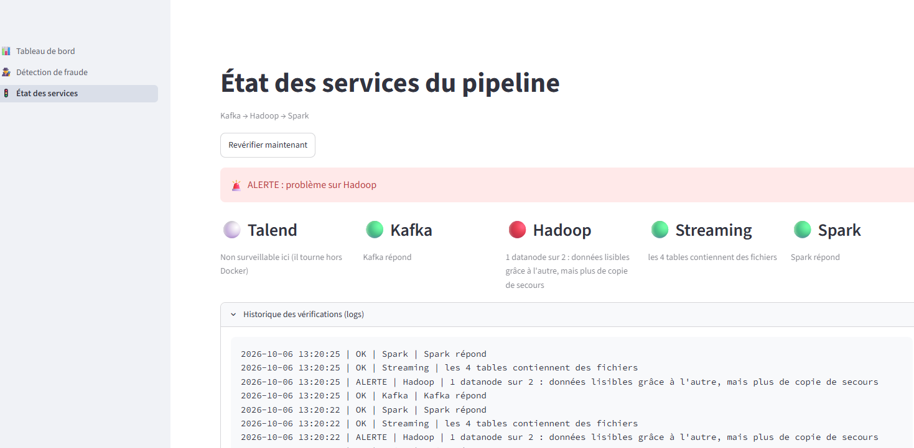

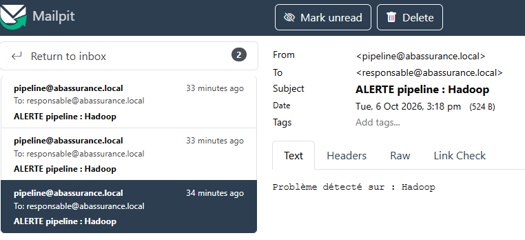

### 7. Correspondance avec les critères de l'US

| Critère | Réalisation |
| --- | --- |
| Un tableau de bord de suivi est mis en place et accessible | Page « État des services » avec un voyant par étape |
| Une alerte automatique est envoyée en cas de problème | Bannière rouge + mail d'alerte (Mailpit) |
| L'historique des traitements (logs) passés est consultable | Fichier `logs/etat_services.log` affiché dans la page |

### 8. Limites connues

* **Talaxie n'est pas surveillé** : il tourne hors Docker.
* **La vérification n'a lieu que lorsque la page est ouverte.** Si personne ne la consulte, aucune alerte ne part. En production, la surveillance serait un programme séparé qui tourne en permanence.
* **Le voyant « Streaming » vérifie que des fichiers existent**, pas que le streaming tourne à cet instant.
* **Le serveur de mail est simulé** (Mailpit) : aucun mail réel n'est envoyé.

### 9. Évolutions possibles en production

* Surveillance continue, alertes via **Alertmanager** (mail, Slack, SMS).
* Vrai serveur de mail d'entreprise.
* Surveillance de Talaxie (état des jobs planifiés).
* Logs centralisés (par exemple Elasticsearch).

## US 6.3 : Mesurer les performances du pipeline

### Objectif

Mesurer le temps de réponse de chaque étape du pipeline, afin de vérifier la fluidité du service et de repérer un éventuel ralentissement.

### Ce qui est mesuré

La page Streamlit « État des services » (`Etat_des_services.py`) vérifie 4 étapes : Kafka, Hadoop, Streaming et Spark. À chaque vérification, chaque étape est chronométrée avec `time.time()` : durée = heure d'arrivée − heure de départ.

Les temps mesurés sont des **temps de réponse des services** : combien de secondes met chaque étape à répondre à la vérification. La durée des traitements eux-mêmes (par exemple `preparer_dataset_fraude.py`) est mesurée dans la US 8.3.

### Où sont les résultats

Chaque mesure est ajoutée à la fin du fichier `logs/performances.csv` par la fonction `noter_mesure` (fichier `outils_perf.py`). Une ligne contient la date, l'étape et la durée en secondes (`duree_s`). Le fichier n'est jamais effacé : il garde tout l'historique.

La page affiche ensuite, dans la section « Performances du pipeline » :

* **un tableau de synthèse** : pour chaque étape, le nombre de mesures, le minimum, la moyenne et le maximum en secondes ;
* **un message de ralentissement**, orange s'il y en a un, vert sinon ;
* **un graphique par étape** (« Évolution des temps dans le temps »).

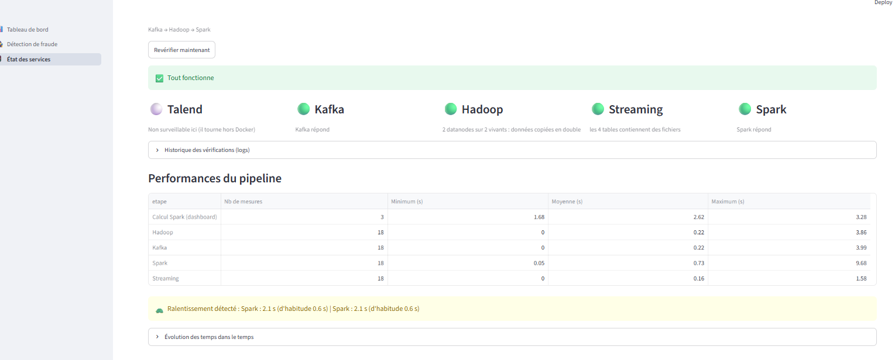
(Capture prise lors du premier démarrage du pipeline, spark mets un peu de temps à démarrer la première fois)

### Comment un ralentissement est détecté

La fonction `detecter_ralentissement` (dans `app/outils.py`) applique une règle simple :

* il faut au moins **4 mesures** pour une étape, afin d'avoir une « habitude » à comparer ;
* la **dernière mesure** est comparée à la moyenne des mesures précédentes ;
* si elle est **plus de 2 fois plus longue**, c'est un ralentissement ;
* les écarts trop petits (moins d'une seconde) sont ignorés, pour ne pas alerter pour rien.

C'est comme un coureur qui fait d'habitude 10 minutes : s'il en met soudain 25, on le signale.

Exemple : Spark : 2,1 s (d'habitude 0,6 s)

Cette fonction est couverte par 7 tests unitaires : pas assez de mesures, temps stable, ralentissement, petit écart ignoré, seuil exact, facteur personnalisé, amélioration.

### Limites et améliorations possibles

* Les temps mesurés sont ceux des vérifications de services, pas ceux des gros traitements Spark.
* La première vérification de Spark peut être plus longue que les suivantes, car la session Spark doit démarrer.
* Le seuil (2 fois la moyenne) est un choix de départ, à ajuster avec l'expérience.
* Les mesures ne sont prises que lorsque la page est ouverte ou actualisée, pas en continu.

### Correspondance avec l'objectif de l'US

| Attendu | Réalisation |
| --- | --- |
| Mesurer le temps de réponse de chaque étape du pipeline | Chaque vérification (Kafka, Hadoop, Streaming, Spark) est chronométrée et enregistrée dans `logs/performances.csv` |
| Vérifier la fluidité du service | Tableau de synthèse par étape (nombre de mesures, minimum, moyenne, maximum) et graphique de l'évolution des temps |
| Repérer un éventuel ralentissement | Fonction `detecter_ralentissement` : message orange si la dernière mesure dépasse 2 fois la moyenne habituelle |
| Résultats vérifiables | `noter_mesure` (6 tests) et `detecter_ralentissement` (7 tests) sont couverts par des tests unitaires (US 7.3) |

## US 7.1 Configuration de SonarQube

La configuration a été faite lors de la mise en route du projet. Cependant, je ne pouvais pas faire d'analyse sans avoir développé une partie ou la totalité de la pipeline.

Première analyse après avoir développé le tableau de bord, l'état de service et le modèle de prédiction de détection de fraude.

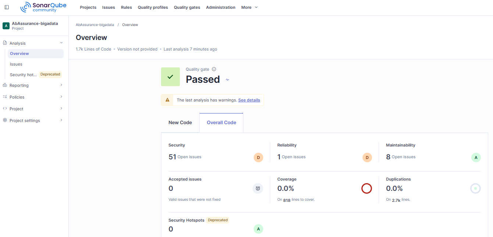

Pour relancer le scan `pysonar --sonar-host-url=http://localhost:9000 --sonar-token=token --sonar-project-key=key`

### Les indicateurs principaux

| Indicateur | Ce que ça mesure |
| --- | --- |
| **Bugs** | Code qui risque de planter ou de donner un mauvais résultat |
| **Vulnérabilités** | Failles de sécurité exploitables (mot de passe écrit dans le code, par exemple) |
| **Security Hotspots** | Passages sensibles à relire à la main pour décider s'ils sont dangereux |
| **Code Smells** | Code qui marche mais qui est mal écrit : fonctions trop longues, variables inutilisées, trop complexe |
| **Dette technique** | Temps estimé pour corriger tous les Code Smells |
| **Duplications** | Pourcentage de code copié-collé |
| **Couverture (Coverage)** | Pourcentage de code exécuté par les tests |
| **Notes A à E** | Une note pour la fiabilité (bugs), la sécurité (vulnérabilités) et la maintenabilité (Code Smells) |
| **Quality Gate** | Réussi ou échoué, selon des seuils fixés par SonarQube |

## US 7.2 Corriger les anomalies SonarQube

### Objectif

Corriger les anomalies les plus importantes détectées par la première analyse (US 7.1), puis vérifier par une nouvelle analyse qu'elles ont diminué et que le code fonctionne toujours.

### Anomalies détectées et après correction

| Catégorie | Nombre d'anomalies | Correction |
| --- | --- |
| Sécurité | 51 | 0 |
| Fiabilité | 1 | 0 |
| Maintenabilité | 8 | 0 |

Avant correction


Après correction

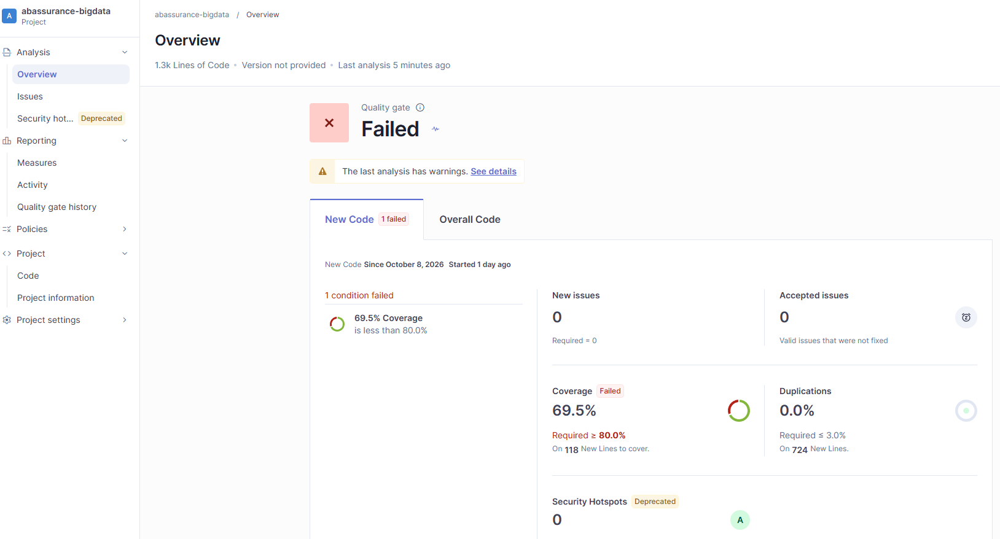

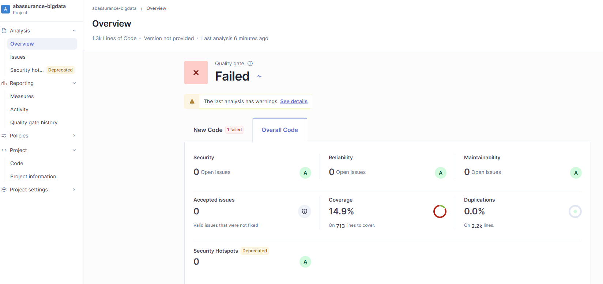

### Vérification que le code fonctionne toujours

Les tests unitaires sont relancés après les corrections (voir les US 7.3 et 7.4) pour vérifier qu'aucune fonction n'a été cassée.

### Analyse finale (19/10/2026)

La dernière analyse SonarQube signale **2 alertes de sécurité**, de même nature, dans `en_ligne/app.py` (lignes 154 et 172) :

> *Using HTTP protocol is insecure. Use HTTPS instead.*

Elles portent sur les deux requêtes envoyées au namenode par la page « Services » :

```python
# Ligne 154 : état des datanodes
adresse = ("http://" + HOTE_NAMENODE + ":9870/jmx"
           "?qry=Hadoop:service=NameNode,name=FSNamesystemState")

# Ligne 172 : contenu des tables écrites par le streaming
adresse = ("http://" + HOTE_NAMENODE + ":9870/webhdfs/v1/data/kafka/"
           + table + "?op=LISTSTATUS")
```

**Pourquoi SonarQube les signale.** HTTP fait circuler les échanges en clair : quelqu'un placé sur le réseau pourrait les lire, comme une carte postale.

**Pourquoi elles ne sont pas corrigées en passant à HTTPS.** Le namenode ne répond qu'en HTTP sur le port 9870. Écrire simplement `https://` ferait échouer la vérification à chaque fois. Passer Hadoop en HTTPS demanderait de créer des certificats, de les installer sur le namenode et les deux datanodes, et de modifier la configuration HDFS (`dfs.http.policy=HTTPS_ONLY`).

**Pourquoi le risque est faible ici :**

* les requêtes restent à l'intérieur du réseau Docker : le port 9870 n'est pas publié vers l'extérieur (voir `docker-compose.yaml`) ;
* elles ne transportent aucune donnée client, seulement l'état technique de HDFS (nombre de datanodes, liste de fichiers) ;
* dans la version en ligne, elles n'atteignent rien, puisque Hadoop n'existe pas sur Streamlit Community Cloud.

**Décision.** Les deux alertes ont été examinées et marquées *Safe* dans SonarQube, avec cette justification. Elles ne sont pas masquées dans le code : elles restent visibles et justifiées.

**En production**, HDFS serait configuré en HTTPS, avec une authentification Kerberos, pour que les échanges entre les services soient chiffrés et que seuls les services autorisés puissent interroger le namenode.

## US 7.3 : Écrire les tests unitaires

### 1. Objectif

Vérifier automatiquement que les fonctions principales du projet donnent les bons résultats, et pouvoir relancer cette vérification à tout moment (après chaque modification du code, par exemple).

Un test unitaire fonctionne comme un contrôle qualité en usine : on donne à une fonction une entrée dont on connaît la bonne réponse, et on vérifie qu'elle ressort comme prévu.

### 2. Installation

Installé dans le container pytest et pytest-cov `docker exec -it pyspark-app pip install pytest pytest-cov`

Puis ajouter au requirements.txt

```txt
pytest==9.1.1
pytest-cov==7.1.0
coverage==7.16.2 
iniconfig==2.3.1 
pluggy==1.6.0 
pygments==2.21.0
```

### 3. Outils utilisés

| Outil | Rôle |
| --- | --- |
| **pytest** | Lance les tests et affiche lesquels réussissent ou échouent |
| **pytest-cov** | Mesure la couverture du code par les tests (voir US 7.4) |

Installation : `pip install pytest pytest-cov pandas fpdf2` (ajoutés aussi à `requirements.txt`).

### 4. Organisation du code pour pouvoir tester

Les pages Streamlit affichent le résultat dès qu'on les importe, et les scripts Spark ont besoin de Hadoop : ils ne se testent pas facilement tels quels.

Deux choix d'organisation permettent de les tester quand même :

* Les fonctions qui ne font que du **calcul** pour l'application (elles reçoivent une donnée, elles renvoient un résultat) sont regroupées dans un fichier à part, `app/outils.py`. Les pages l'importent et l'utilisent, et les tests aussi.
* Dans `src/pipeline/preparer_dataset_fraude.py`, la logique n'est plus écrite directement dans le bloc `if __name__ == "__main__":`. Chaque étape est une **fonction** (résumer les paiements, lier les tables, calculer les écarts, trier les lignes...). Le bloc principal se contente de les appeler dans l'ordre, et les tests appellent ces mêmes fonctions avec un Spark local et de petites tables.

```shell
abassurance-bigdata/
├── app/
│   ├── app.py, outils.py, outils_perf.py, outils_auth.py, auth.py
│   └── pages/
├── en_ligne/
│   └── app.py                           ← version en ligne (pandas, sans Spark)
├── src/
│   └── pipeline/
│       ├── preparer_dataset_fraude.py   ← logique découpée en fonctions
│       └── nettoyage_donnees_ia.py      ← nettoyage et harmonisation des données
├── tests/
│   ├── test_outils.py                   ← tests unitaires de l'application
│   ├── test_outils_perf.py              ← tests du carnet de chronos
│   ├── test_outils_auth.py              ← tests de l'authentification
│   ├── test_en_ligne.py                 ← tests de bout en bout de la version en ligne
│   ├── test_preparer_dataset_fraude.py  ← tests unitaires du pipeline
│   └── test_nettoyage_donnees_ia.py     ← tests du nettoyage
├── pytest.ini                           ← indique à pytest où trouver outils.py
├── .coveragerc                          ← exclusion du bloc de lancement du calcul de couverture
├── sonar-project.properties             ← réglages de l'analyse SonarQube
└── lancer_tests.py                      ← tests, couverture et analyse en une commande

```

Les tests du pipeline s'exécutent **dans le conteneur** `pyspark-app` (là où Spark est installé). Le rapport de couverture (`coverage_fraude.xml`) est ensuite copié sur le poste, puis l'adresse `/app` qu'il contient est remplacée par le dossier réel du projet pour que SonarQube retrouve les fichiers.

### 5. Ce qui est testé

#### 5.1 Application : 46 tests sur 11 fonctions de `app/outils.py` et `app/outils_perf.py`

| Fonction | Rôle | Nb de tests | Cas vérifiés |
| --- | --- | --- | --- |
| `vers_csv` | Tableau → CSV lisible dans Excel | 3 | Marqueur UTF-8, séparateur `;`, pas de colonne numéro |
| `probas_en_pourcentage` | Probabilité de fraude (0,875) → pourcentage entier (88) pour l'export CSV | 5 | Conversion et arrondi, case vide conservée, colonne renommée `proba_fraude (%)`, tableau d'origine intact, contenu du CSV |
| `texte_pdf` | Remplace les caractères inconnus du PDF | 3 | Accents conservés, emoji remplacé, texte vide |
| `generer_rapport_pdf` | Fabrique le rapport PDF | 2 | Fichier commençant par `%PDF`, cas sans statut |
| `tester_porte` | Vérifie qu'un service répond | 3 | Service ouvert, port fermé, machine inconnue |
| `interpreter_datanodes` | Voyant Hadoop (réplication) | 7 | 2/2 vert, 1/2 rouge mais données lisibles, datanode silencieux, 0 datanode, 3e datanode, nombre attendu personnalisé |
| `trouver_pannes` | Liste les étapes en panne | 4 | Aucune, une, plusieurs, liste vide |
| `formater_ligne_log` | Ligne du carnet de bord | 2 | Ligne `OK`, ligne `ALERTE` |
| `construire_mail` | Contenu du mail d'alerte | 4 | Sujet, texte, adresses par défaut et personnalisées |
| `detecter_ralentissement` | Détection d'un ralentissement | 7 | Pas assez de mesures, temps stable, ralentissement, petit écart ignoré, seuil exact, facteur personnalisé, amélioration |
| `noter_mesure` | Ajoute une mesure de temps dans le carnet de chronos | 6 | Fichier et titres créés, étape et durée écrites, titres écrits une seule fois, anciennes mesures conservées, durée arrondie à 3 décimales, dossier non inscriptible sans plantage |

Ces tests utilisent un dossier temporaire créé par pytest : le vrai fichier `logs/performances.csv` n'est jamais touché.

#### 5.2 Pipeline fraude : 11 tests sur 8 fonctions de `preparer_dataset_fraude.py`

| Fonction | Rôle | Nb de tests | Cas vérifiés |
| --- | --- | --- | --- |
| `resumer_paiements` | Un total par contrat | 1 | Nombre de paiements et de paiements échoués |
| `completer_contrats` | Complète la prime annuelle et le type d'assurance | 1 | Prime mensuelle × 12 pour AssurePlus, type déduit du code produit, `ASSIST` devient `ASSISTANCE`, contrat AbAssurance inchangé |
| `lie_contrat_sinistre` | Rattache contrat et paiements à chaque sinistre | 1 | Jointure `left`, colonnes des 3 tables présentes |
| `ecart_debut_contrat_sinistre` | Jours entre début du contrat et sinistre | 2 | Écart de 10 jours, dates manquantes (écart vide, valeurs nulles remplacées par 0) |
| `lignes_coherentes` | Écarte les lignes incohérentes | 3 | Montant nul, écart négatif, jeu vide |
| `separer_entrainement_a_predire` | Deux piles : score de fraude connu / inconnu | 1 | Un sinistre dans chaque pile |
| `ajouter_etiquette_suspect` | Score (0-100) → étiquette suspect (1) ou non (0) | 1 | Frontière du seuil (69 → 0, 70 → 1) |
| `garder_colonnes_utiles` | Garde seulement les colonnes utiles | 1 | Colonne inutile supprimée |

Ces tests utilisent un vrai Spark local avec de petites tables créées dans le test : ils ne dépendent pas de HDFS.

**Bug identifié (voir Dossier 3, Question 3).** Un des tests de `lignes_coherentes` documente un risque : une date vide donne un écart vide, et la ligne est écartée sans message. Le programme principal affiche désormais le nombre de lignes écartées.

**Ce qui n'est pas couvert par les tests unitaires** : `demarrer_spark` (ligne 18) et `lire_nettoyer_tables` (lignes 32 à 52), qui se branchent sur HDFS. Elles se vérifient en conditions réelles, en lançant le pipeline. Couverture actuelle du fichier : 68 %.

#### 5.3 Nettoyage : 13 tests sur 7 fonctions de `nettoyage_donnees_ia.py`

| Fonction | Rôle | Nb de tests | Cas vérifiés |
| --- | --- | --- | --- |
| `nettoyer` | Enlève les espaces et transforme les textes vides en `null` | 3 | Espaces supprimés, texte vide ou fait d'espaces devenu `null`, nombres inchangés |
| `harmoniser_statuts` | Traduit les statuts anglais en français | 5 | Clients, contrats, sinistres, transactions (par exemple `FAILED` → `ECHOUE`), table sans colonne de statut. Un statut déjà en français, vide ou inconnu n'est pas modifié |
| `lire_fichier` | Lit un CSV séparé par des points-virgules | 1 | Deux colonnes, accents conservés |
| `preparer_clients` | Nettoyage complet de la table clients | 1 | Doublon supprimé, espaces enlevés, statuts traduits |
| `preparer_contrats` | Nettoyage complet des contrats | 1 | Famille de produit, prime mensuelle × 12, durée du contrat, doublon supprimé, statuts traduits |
| `preparer_paiements` | Résumé des paiements par contrat | 1 | Nombre, total payé, paiements échoués, doublon non compté |
| `preparer_sinistres` | Résumé des sinistres par contrat | 1 | Nombre, total estimé, sinistres rejetés, doublon non compté |

Ces tests tournent dans le conteneur, comme ceux du pipeline. Couverture du fichier : 100 %.

Les fonctions `preparer_*` ne sont appelées par aucun script du pipeline actuel (le script de préparation applique `nettoyer` et `harmoniser_statuts` lui-même). Elles sont testées pour garantir leur logique en cas de réutilisation.

#### 5.4 Authentification : 17 tests sur `app/outils_auth.py`

| Fonction | Rôle | Nb de tests | Cas vérifiés |
| --- | --- | --- | --- |
| `hacher_mot_de_passe` / `verifier_mot_de_passe` | Hachage PBKDF2 et vérification | 7 | Hash différent à chaque fois mais vérifiable, mauvais mot de passe refusé, 5 formes de hash invalide qui ne font pas planter |
| `authentifier` | Connexion : renvoie le rôle | 2 | Bon rôle renvoyé, mauvais mot de passe ou identifiant inconnu refusés |
| `charger_utilisateurs` | Lecture des comptes (`AUTH_USERS`) | 7 | Fichier valide lu, 6 fichiers invalides refusés (JSON incorrect, liste, objet vide, valeur vide, hash manquant, rôle inconnu) |
| `pages_autorisees` | Pages visibles selon le rôle | 1 | admin : 3 pages, user : tableau de bord et fraude, rôle inconnu : aucune |

#### 5.5 Version en ligne : 20 tests de bout en bout sur `en_ligne/app.py`

Ces tests utilisent `AppTest` de Streamlit, qui joue le rôle d'un navigateur « robot » : il lance l'application, remplit le formulaire de connexion, clique sur les boutons, puis on vérifie ce qui s'affiche. Ils tournent sur de petites données créées pour le test, dans un dossier temporaire : les vrais fichiers de `en_ligne/donnees` et les vrais comptes (`.streamlit/secrets.toml`) ne sont jamais utilisés.

| Domaine | Nb de tests | Cas vérifiés |
| --- | --- | --- |
| Connexion | 6 | Formulaire affiché, application fermée sans compte configuré, 3 connexions refusées, déconnexion |
| Onglets selon le rôle | 2 | user : tableau de bord et fraude ; admin : en plus les services |
| Tableau de bord | 5 | Chiffres clés, contrats par statut (dont statut vide), montant total des sinistres, un bouton d'export par table, message clair si les fichiers manquent |
| Fraude | 3 | Qualité du modèle, curseur de seuil, message clair si les prédictions manquent |
| Services (admin) | 4 | Attente du clic, alerte quand les services sont injoignables, streaming non vérifié si Hadoop est absent, résultat conservé après un autre clic |

Ces tests couvrent aussi `app/auth.py` (formulaire de connexion), à 83 %.

### 6. Comment lancer les tests

Deux commandes, selon l'endroit où les tests s'exécutent. Les tests de l'application (outils, authentification, version en ligne) tournent directement sur le poste, ceux du pipeline et du nettoyage ont besoin de Spark et tournent dans le conteneur `pyspark-app`.

```shell
# Tests de l'application, sur le poste (depuis la racine du projet)
pytest tests/test_outils.py tests/test_outils_perf.py tests/test_outils_auth.py tests/test_en_ligne.py

# Chaîne complète : tests du pipeline dans le conteneur, tests de l'application,
# couverture, puis analyse SonarQube (voir l'US 7.4)
python lancer_tests.py
```

Pour obtenir aussi la couverture et un rapport de résultats consultable :

```shell
(.venv) PS C:\xampp\htdocs\Projets\abassurance-bigdata> python lancer_tests.py

---- Tests du pipeline, dans le conteneur ----
Name                                      Stmts   Miss  Cover   Missing
-----------------------------------------------------------------------
src/pipeline/nettoyage_donnees_ia.py         45      0   100%
src/pipeline/preparer_dataset_fraude.py      56     18    68%   18, 32-52
-----------------------------------------------------------------------
TOTAL                                       101     18    82%
Coverage XML written to file /app/coverage_fraude.xml
24 passed

---- Tests de l'application, sur le poste ----
Name                 Stmts   Miss  Cover   Missing
--------------------------------------------------
app\app.py             115    115     0%   3-274
app\auth.py             58     10    83%   31-33, 47-48, 65-66, 73-75
app\outils.py           78      0   100%
app\outils_auth.py      45      0   100%
app\outils_perf.py      15      0   100%
en_ligne\app.py        147     26    82%   146, 156-158, 163, 168-181, 192-199, 249
--------------------------------------------------
TOTAL                  458    151    67%
Coverage XML written to file coverage.xml
83 passed
```

### 7. Consulter les résultats

* **Dans le terminal** : pytest affiche un point par test réussi et la liste détaillée de ceux qui échouent (avec la ligne fautive et la valeur obtenue).
* **Dans un fichier** : `logs/rapport_tests.xml` (format JUnit, lisible par la plupart des outils de suivi).
* **Dans SonarQube** : la couverture produite par les tests (`coverage.xml`) est lue lors de l'analyse (voir US 7.4).

### 8. Correspondance avec les critères de l'US

| Critère | Réalisation |
| --- | --- |
| Les composants principaux disposent de tests unitaires | 107 tests : 40 sur `outils.py`, 6 sur `outils_perf.py`, 17 sur `outils_auth.py`, 20 sur la version en ligne, 11 sur `preparer_dataset_fraude.py` et 13 sur `nettoyage_donnees_ia.py`. Voir les limites ci-dessous |
| Les tests s'exécutent sans erreur | `python lancer_tests.py` : 83 tests réussis sur le poste et 24 tests Spark réussis dans le conteneur |
| Les résultats des tests sont consultables | Terminal, fichier `logs/rapport_tests.xml`, SonarQube |
| Les tests peuvent être relancés automatiquement | Script `lancer_tests.py` ; intégration continue décrite pour la production |

### 9. Limites connues

**Seule une partie du code est testée unitairement.** La logique de `outils.py`, `outils_perf.py` et `outils_auth.py`, la version en ligne, le nettoyage et les fonctions de `preparer_dataset_fraude.py` sont couverts. Les pages Streamlit de la version complète (qui démarrent Spark), les scripts de streaming et l'entraînement du modèle ne le sont pas. Ils sont vérifiés autrement : par les comptages de l'US 1.4, par les échantillons du tableau de bord (US 5.1) et par les métriques du modèle (US 5.3).

### 10. Évolutions possibles

* Tests des fonctions de `entrainer_modele_fraude.py` qui ne dépendent pas de HDFS (préparation des colonnes, construction du pipeline).
* Tests d'intégration lancés dans Docker avec le pipeline complet.
* Intégration continue avec blocage de la livraison si un test échoue.

## US 7.4 : Atteindre la couverture de test de code minimale

### Objectif

Atteindre une couverture minimale de 60 % sur les fichiers qui contiennent de la logique et des calculs : `app/outils.py`, `app/outils_perf.py`, `app/outils_auth.py`, `en_ligne/app.py`, `src/pipeline/nettoyage_donnees_ia.py` et `src/pipeline/preparer_dataset_fraude.py`.

Les tests unitaires ne sont pas écrits sur tout le code : les pages Streamlit de la version complète, les scripts de streaming et le générateur de données dépendent de Spark, de Kafka ou de HDFS.

### Résultats

| Fichier | Nombre de tests | Couverture | Seuil de 60 % |
| --- | --- | --- | --- |
| `app/outils.py` | 40 | 100 % | Atteint |
| `app/outils_perf.py` | 6 | 100 % | Atteint |
| `app/outils_auth.py` | 17 | 100 % | Atteint |
| `en_ligne/app.py` | 20 | 82 % | Atteint |
| `app/auth.py` | (couvert par les tests de la version en ligne) | 83 % | Atteint |
| `src/pipeline/nettoyage_donnees_ia.py` | 13 | 100 % | Atteint |
| `src/pipeline/preparer_dataset_fraude.py` | 11 | 68 % | Atteint |

Dans `en_ligne/app.py`, les lignes non couvertes sont les cas où **les services répondent** (Kafka joignable, réponse du namenode, tables du streaming trouvées, Spark qui calcule) : les tests tournent sans Kafka, Hadoop ni Spark, ils ne jouent donc que les cas de panne. Les cas où tout fonctionne se vérifient dans la version complète, où les voyants passent au vert.

Couverture affichée par SonarQube :

| Mesure | Avant exclusion | Après exclusion |
| --- | --- | --- |
| Nouveau code (*New Code*) | 47,1 % | **55,1 %** |
| Ensemble du projet (*Overall Code*) | 27,4 % | **61 %** |

**Fichiers exclus du calcul de couverture.** Certains fichiers ne peuvent pas être testés unitairement : ils démarrent Spark, lisent Hadoop ou Kafka, ou ne font qu'afficher des pages Streamlit. Ils sont exclus du **calcul de couverture** dans `sonar-project.properties`, mais restent **analysés par SonarQube pour la qualité** (bugs, sécurité, maintenabilité) :

```properties
sonar.coverage.exclusions=app/app.py,app/pages/**,streaming_topics/**,src/prediction/**,generate_dataset.py,tools/**
```

Leur logique de calcul a été déplacée dans des fichiers testés (`outils.py`, `preparer_dataset_fraude.py`, `nettoyage_donnees_ia.py`). Sans cette exclusion, le pourcentage mélangerait le code testable avec du code qui ne peut l'être qu'en conditions réelles, et ne dirait plus rien de la qualité des tests. Les deux mesures (avant et après) sont données pour que la différence reste visible.

Le chiffre du nouveau code (55,1 %) porte uniquement sur les lignes modifiées récemment. Il est plus bas que celui de l'ensemble du projet, car une partie de ces lignes ne peut être exécutée qu'avec les services lancés, comme les cas « service joignable » de la page Services. Le détail fichier par fichier est consultable dans SonarQube.

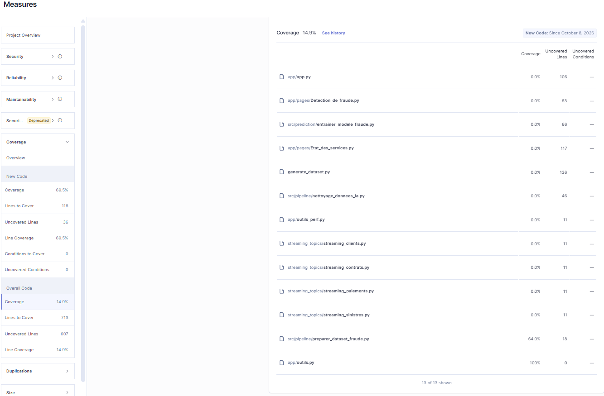

### Comment la couverture est mesurée

La couverture est le pourcentage de lignes de code exécutées par au moins un test. L'outil utilisé est `pytest-cov`, et le résultat est envoyé à SonarQube.

* Les tests de `outils.py`, `outils_perf.py`, `outils_auth.py` et de la version en ligne tournent directement sur le poste.
* Les tests de `preparer_dataset_fraude.py` et `nettoyage_donnees_ia.py` tournent dans le conteneur Docker `pyspark-app`, là où Spark est installé. Ils sont lancés dans **une seule commande** pytest, pour que le rapport de couverture (`coverage_fraude.xml`) contienne les deux fichiers : chaque lancement de pytest réécrit son rapport en entier.
* Chaque exécution produit un rapport XML (`coverage.xml` et `coverage_fraude.xml`). Pour le rapport du conteneur, l'adresse `/app` qu'il contient est remplacée par le dossier réel du projet, afin que SonarQube retrouve les fichiers.
* Le fichier `.coveragerc` exclut le bloc `if __name__ == "__main__":`. Ce bloc ne fait qu'appeler les fonctions dans l'ordre : la logique est dans les fonctions, qui sont testées.

Tout se relance avec une seule commande :

```shell
python lancer_tests.py
```

Le script envoie les fichiers dans le conteneur, lance les deux séries de tests, récupère les rapports et lance l'analyse SonarQube. Il s'arrête dès qu'un test échoue. Le token SonarQube est lu dans un fichier `.env`, qui n'est pas versionné.

### Parties non couvertes

Pour `preparer_dataset_fraude.py`, 32 % du code n'est pas couvert :

* `demarrer_spark` (ligne 18) : elle démarre une session Spark connectée à HDFS.
* `lire_nettoyer_tables` (lignes 32 à 52) : elle lit les tables Parquet dans HDFS.

Ces deux fonctions dépendent de Hadoop. Elles ne se testent pas en test unitaire simple, mais se vérifient en conditions réelles, en lançant le pipeline.

### Améliorations possibles

* Tester `lire_nettoyer_tables` avec un faux Spark qui renvoie de petites tables, sans passer par HDFS.
* Tester les fonctions de `entrainer_modele_fraude.py` qui ne dépendent pas de HDFS.
* Déclencher automatiquement les tests à chaque `git push` (intégration continue). Aujourd'hui, ils se relancent en une commande, mais à la main.

## US 8.3 : Optimiser les performances

### Objectif

Réduire le temps de traitement du script de préparation du dataset fraude (`preparer_dataset_fraude.py`), en mesurant la durée avant et après chaque optimisation.

### Méthode de mesure

* Un chronomètre (`time.perf_counter()`) mesure la durée du pipeline, de la lecture des tables HDFS à l'écriture des résultats. Le démarrage de Spark n'est pas compté.
* Chaque version est lancée **3 fois** dans le conteneur `pyspark-app`, dans la foulée. Une seule mesure peut être faussée par un hasard (un autre programme qui tourne, l'état du disque).
* On compare les **médianes** (la valeur du milieu), qui ignorent un lancement exceptionnellement lent ou rapide.
* Le jeu de données est petit : 98 sinistres, dont 37 pour l'entraînement.

### Résultats

| Version | Mesures (s) | Médiane (s) | Écart avec la référence |
| --- | --- | --- | --- |
| Référence | 9,30 / 9,04 / 8,95 | 9,04 | n/a |
| Essai 1 : `cache()` | 15,96 / 16,10 / 15,88 / 15,72 | 15,92 | +6,88 s (+76 %) |
| Essai 2 : 4 partitions de calcul | 8,64 / 8,63 / 8,17 | 8,63 | −0,41 s (−4,5 %) |

### Essai 1 : le cache (abandonné)

L'idée était de garder le dataset en mémoire pour ne pas refaire le calcul à chaque `count()`, `show()` et écriture. Le résultat est l'inverse de l'attendu : le pipeline est plus lent. Sur 98 lignes, l'opération de mise en mémoire coûte plus cher que le recalcul. Cet essai a été abandonné.

### Essai 2 : réduire les partitions de calcul (retenu)

Par défaut, Spark découpe les jointures et les regroupements en 200 morceaux (`spark.sql.shuffle.partitions`). Pour 98 lignes, c'est démesuré. Le réglage a été ramené à 4 dans `demarrer_spark` :

```python
.config("spark.sql.shuffle.partitions", "4")
```

Le gain est de 0,41 s (4,5 %), constant sur les 3 lancements. Le résultat du pipeline est identique (37 lignes d'entraînement, 61 à prédire, 7 suspects pour 30 non suspects) et les 10 tests unitaires passent toujours.

### Limites

* Le gain est faible et mesuré sur seulement 3 lancements.
* Les volumes réels d'AbAssurance sont sans commune mesure avec ce jeu de données. Le comportement de ces deux optimisations y serait probablement différent : le cache deviendrait sans doute utile, et 4 partitions seraient trop peu. Elles seraient à retester sur de gros volumes.

### Piste non testée

Réduire le nombre de `count()` dans le programme principal : chacun relance tout le calcul.

## US 8.4 : Documenter le projet

### Objectif

Permettre à une autre personne (un correcteur, un futur développeur) de comprendre, installer, lancer et vérifier le projet sans aide.

### Documents produits

| Document | Contenu |
| --- | --- |
| `README.md` (racine du dépôt) | Liens et accès, architecture, convention de nommage des branches, installation, lancement pas à pas, tests |
| `journal_technique.md` | Choix techniques, problèmes rencontrés et solutions, réalisation de chaque User Story |
| `MODE_DEMO.md` | Différences entre la version en ligne et la version complète, préparation de la démonstration, mise à jour des données en ligne |
| `rapport_qualite.md` | Résultats SonarQube, tests unitaires et couverture |
| `mapping_donnees.md` | Correspondance des champs AbAssurance / AssurePlus vers le modèle commun |
| `regles_nettoyage.md` | Règles de nettoyage appliquées aux données |
| `dictionnaire_dataset.md` | Description des colonnes du jeu de données de la détection de fraude |
| `MCDs/` | Modèles conceptuels des deux sources et du modèle final |

Le code est lui-même commenté en français, avec des explications en langage simple.

### Revue de cohérence (16/10/2026)

Avant le dépôt, le projet a été relu en entier pour vérifier que le code et la documentation disent la même chose. Les écarts trouvés ont été corrigés, notamment :

* les nombres de tests et les pourcentages de couverture, qui différaient d'un document à l'autre (US 7.3, US 7.4 et rapport de qualité) ;
* des liens cassés (titres du sommaire, nom de fichier `MODE_DEMO.md` dont la casse différait des liens) ;
* des parties de l'US 6.3 recopiées par erreur depuis l'US 6.2 ;
* la description des droits d'accès aux pages, et des tests qui attendaient encore l'ancienne règle (le profil user voit aussi la détection de fraude) ;
* la procédure de mise à jour des données en ligne, qui passe désormais par `tools/exporter_data_demo.py` pour ne jamais publier les colonnes sensibles.

## Authentification et rôles (accès admin / user)

### Objectif

Protéger l'application par une connexion obligatoire, avec deux profils : un administrateur (`admin`) qui voit toutes les pages et un utilisateur (`user`) qui voit le tableau de bord et la détection de fraude.

### Fonctionnement

* **Connexion obligatoire.** L'application appelle `exiger_connexion()` tout en haut de `app.py`, avant de démarrer Spark ou de lire les données. Tant que l'utilisateur n'est pas identifié, seul le formulaire de connexion s'affiche.
* **Les comptes ne sont pas dans le code.** Ils sont dans la variable d'environnement `AUTH_USERS` : un texte JSON qui associe chaque identifiant à un mot de passe haché et à un rôle. Avec Docker, elle est lue dans le fichier `Docker/auth.env` (instruction `env_file` du `docker-compose.yaml`). Hors Docker, elle peut aussi venir du fichier `.streamlit/secrets.toml`. Ces fichiers ne sont jamais envoyés sur Git.
* **Les mots de passe ne sont jamais stockés en clair.** On conserve un *hash* PBKDF2-SHA256 salé (200 000 itérations), au format `pbkdf2_sha256$itérations$sel$hash`, calculé avec la bibliothèque standard de Python (`hashlib`, `hmac`). Un hash fonctionne comme un broyeur : on peut vérifier qu'un mot de passe correspond, mais on ne peut pas reconstituer le mot de passe à partir du résultat. Le sel (une chaîne aléatoire ajoutée avant le calcul) fait que deux comptes avec le même mot de passe n'ont pas le même hash.
* **Vérification prudente.** Le mot de passe est comparé avec `hmac.compare_digest` (comparaison en temps constant, qui évite de deviner le mot de passe en mesurant le temps de réponse). Quand l'identifiant n'existe pas, un hash factice est quand même vérifié, pour que le temps de réponse ne révèle pas si un compte existe.
* **L'application est fermée par défaut.** Si `AUTH_USERS` est absente ou invalide (JSON incorrect, hash manquant, rôle inconnu), un message d'erreur s'affiche et l'application s'arrête : elle ne s'ouvre jamais sans comptes configurés.
* **Limitation des essais.** Après 5 échecs de connexion, le formulaire est bloqué pendant 30 secondes.
* **Déconnexion.** Un bouton dans la barre latérale efface le rôle de la session.

### Rôles et pages

| Page | `admin` | `user` |
| --- | --- | --- |
| Tableau de bord | Oui | Oui |
| Détection de fraude | Oui | Oui |
| État des services | Oui | Non |

Le menu n'affiche que les pages autorisées pour le rôle (`PAGES_PAR_ROLE` dans `outils_auth.py`). Chaque page vérifie aussi le rôle dès sa première ligne, avec `exiger_role(...)` : « État des services » appelle `exiger_role("admin")`, « Détection de fraude » appelle `exiger_role("admin", "user")`. Un utilisateur qui taperait directement l'adresse d'une page non autorisée reçoit un message d'accès refusé.

### Organisation du code

Comme pour `outils.py`, la logique est séparée de l'affichage pour pouvoir être testée :

| Fichier | Rôle |
| --- | --- |
| `app/outils_auth.py` | Logique sans Streamlit : hachage, vérification, lecture des comptes, pages par rôle |
| `app/auth.py` | Interface Streamlit : formulaire de connexion, contrôle du rôle, déconnexion |
| `tools/generer_hash.py` | Outil en ligne de commande qui fabrique la valeur de `AUTH_USERS` |
| `Docker/auth.env.example` | Modèle du fichier de comptes, sans vrai hash |
| `tests/test_outils_auth.py` | Tests unitaires de `outils_auth.py` |

### Créer les comptes

```powershell
# 1. Depuis la racine du projet : l'outil demande un identifiant, un rôle et un mot de passe
#    pour chaque compte, puis affiche la valeur de AUTH_USERS
python tools/generer_hash.py

# 2. Copier le modèle puis y coller la valeur affichée (une seule ligne, JSON entouré d'apostrophes)
copy Docker\auth.env.example Docker\auth.env

# 3. Recréer le conteneur pour qu'il relise le fichier
cd Docker
docker compose up -d --force-recreate app
```

### Tests

Les tests de `outils_auth.py` vérifient : un hash différent à chaque fois mais toujours vérifiable, un mauvais mot de passe refusé, un hash invalide qui ne fait pas planter (cinq formes de hash invalide testées), la connexion qui renvoie le bon rôle, un identifiant inconnu refusé, la lecture d'un fichier de comptes valide, le refus de fichiers de comptes invalides (JSON incorrect, liste, objet vide, hash manquant, rôle inconnu) et les pages affichées selon le rôle. Le nombre exact de tests est celui affiché par `pytest` ; à reporter dans l'US 7.3.

### Limites connues

* **La limitation des essais dépend de la session du navigateur.** Recharger la page remet le compteur à zéro : ce n'est pas une vraie protection contre les attaques par essais répétés. En production, elle serait bloquer pendant plusieurs heures, où il faudrait faire un système avec l'authentification à deux facteurs.
* **Pas de HTTPS en local** (`http://localhost:8501`). En ligne, le chiffrement est assuré par l'hébergeur.
* **Comptes statiques** : pas de création de compte depuis l'application, pas de réinitialisation de mot de passe, pas d'authentification à deux facteurs. En production, on utiliserait un annuaire d'entreprise (SSO).
* **Comptes de démonstration** : les mots de passe des comptes donnés au correcteur dans le README sont créés pour l'examen uniquement, et ne doivent être utilisés nulle part ailleurs.

## Déploiement en ligne et mode démo

### Objectif

Rendre l'application consultable par le correcteur sans qu'il ait à installer Docker, Kafka, Hadoop et Spark.

### Choix retenu

Toute la plateforme (Kafka, Hadoop avec un namenode et deux datanodes, Spark, Mailpit) ne peut pas tourner sur un hébergement gratuit : la mémoire est limitée, Java n'est pas disponible et il n'est pas possible d'y lancer plusieurs conteneurs. Le projet a donc deux versions de l'application :

* **La version en ligne** (`en_ligne/`, Streamlit Community Cloud) lit des exports Parquet des tables de Hadoop avec pandas. C'est une vitrine des résultats du pipeline.
* **La version complète** (`app/`, Docker) contient tout le pipeline. C'est elle qui sert à la démonstration de la soutenance.

Certaines fonctionnalités n'existent que dans la version complète, car elles ont besoin du pipeline : simulateur de fraude, règles de l'arbre de décision, alertes mail, journal des vérifications, mesures de performance. La page « État des services » est présente en ligne pour l'administrateur, mais ses voyants y sont rouges, car les services ne sont pas joignables hors du réseau Docker : c'est le comportement attendu.

Le tableau complet des différences, la préparation de la démonstration et la mise à jour des données en ligne sont décrits dans [`MODE_DEMO.md`](./MODE_DEMO.md).

